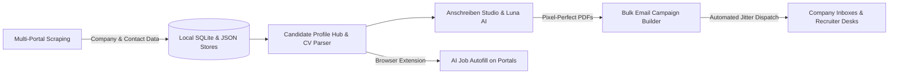

# 🚀 JobScout – AI Job Application Studio & Outreach Suite

[](https://www.python.org/)
[](https://flask.palletsprojects.com/)
[](https://www.selenium.dev/)
[](https://openai.com/)
[](https://sqlite.org/)
[](tests/)

**JobScout** is a high-performance, automated job intelligence, AI candidate matching, personalized cover letter generation, and bulk email outreach platform purpose-built for the German employment market (including **Fachkräfte**, **Ausbildung**, and **Duales Studium**).

---

## 📑 Table of Contents

- [🌟 Platform Overview](#-platform-overview)
- [🧩 Functional Modules](#-functional-modules)
- [1. Discovery & Scraping Hub](#1-discovery--scraping-hub)
- [2. Anschreiben Studio (Cover Letter & PDF Engine)](#2-anschreiben-studio-cover-letter--pdf-engine)
- [3. Bulk Email Campaign Builder](#3-bulk-email-campaign-builder)
- [4. AI Job Autofill Hub & Chrome Extension](#4-ai-job-autofill-hub--chrome-extension)
- [5. Analytics, Supabase & Money Monitor](#5-analytics-supabase--money-monitor)
- [🧠 Luna AI Studio & Zero-Cost Cache](#-luna-ai-studio--zero-cost-cache)
- [🏗️ System Architecture](#️-system-architecture)
- [🔌 Modular API Endpoints](#-modular-api-endpoints)
- [⚡ Quickstart & Installation](#-quickstart--installation)
- [🧪 Testing Suite](#-testing-suite)
- [🔒 Privacy & Compliance](#-privacy--compliance)

---

## 🌟 Platform Overview

JobScout unifies the complete application lifecycle into a single, responsive Single Page Application (SPA):



---

## 🧩 Functional Modules

### 1. Discovery & Scraping Hub
- **Unified Job Finder (`/`)**: Simultaneous search across:
  - **Bundesagentur für Arbeit (Arbeitsagentur)**
  - **Ausbildung.de**
  - **Azubiyo.de**
  - **AUBI-plus.de**
  - **IHK Lehrstellenbörse**
- **Deep Contact Crawler**:
  - Automatically crawls company career sites and legal notices (`/impressum`).
  - Heuristic detection of HR contact persons, telephone numbers, and email patterns (`first.last@company.de`).
  - Tech stack profiling (React, Python, AWS, Docker, SAP, etc.) via [`scraper/tech_detector.py`](file:///c:/Users/provincesettat/Desktop/pro-main/scraper/tech_detector.py).
- **Shared Search Filter Engine ([`scraper/search_filter_engine.py`](file:///c:/Users/provincesettat/Desktop/pro-main/scraper/search_filter_engine.py))**:
  - **Linguistic Profession Matching**: Isolates core profession stems from generic German qualifiers (*Ausbildung zum*, *Lehre als*, *Duales Studium*, *m/w/d*), expands morphological suffixes (`-er`/`-in`, `-mann`/`-frau`), and enforces negative boundary conflicts (e.g. rejecting *Kaufmann* or *Informatiker* when querying *Koch*).
  - **Location Sanitization & Commuter Radius**: Strips UI artifact tags (`Video`, `Online`, `Duales Studium`), extracts 5-digit German postal codes (PLZ) and clean city names, prevents silent nationwide fallback leaks, and matches regional commuter zones.
  - **Accurate Publication Date Separation**: Disentangles original `published_date` from discovery timestamp `scraped_at`, parses standard German formats (`DD.MM.YYYY`, `YYYY-MM-DD`) and relative expressions (`vor X Tagen`), ensuring only genuinely current positions pass period filters.
  - **Cross-Source Deduplication & Accurate Count**: Normalizes and deduplicates listings across all 5 job portals before rendering result counts, ensuring displayed `Stellen gefunden` matches the actual valid dataset.
- **Deep Bewerbungsformular Discovery & 5-Tier Verification ([`scraper/application_form_discovery.py`](file:///c:/Users/provincesettat/Desktop/pro-main/scraper/application_form_discovery.py))**:
  - Distinguishes 5 application link tiers:
    1. *Verified direct application form* (`has_form = True`, autofill eligible).
    2. *Verified job-specific application starting page* (`has_form = True`, autofill eligible).
    3. *Generic careers page* (`has_form = False`).
    4. *Ordinary job advertisement* (`has_form = False`).
    5. *Missing / Inaccessible destination*.
  - UI strictly renders `Online-Bewerbungsformular` and enables `Mit Formular bewerben (Autofill)` only for verified forms (Tiers 1 & 2), providing `Stellenanzeige öffnen` or `Karriereseite öffnen` for unverified ads.
- **Google Maps Mandatory Exception & Ausbildung Verifier ([`scraper/google_maps_ausbildung_verifier.py`](file:///c:/Users/provincesettat/Desktop/pro-main/scraper/google_maps_ausbildung_verifier.py))**:
  - **Mandatory Website Inspection**: For every business discovered via Google Maps, visiting and inspecting its official website is mandatory, regardless of email availability.
  - **Career & Ausbildung Verification**: Opens the company's official website, crawls careers and Ausbildung subpages, and verifies whether an actual Ausbildung vacancy matching the requested profession exists.
  - **Contact & Application Routing**:
    - If a matching vacancy exists, extracts the title, original vacancy URL, and business application email.
    - If no email exists, follows application links to discover the authentic online application form (`has_form = True`).
    - If no matching vacancy is found or website is inaccessible, the company is retained as an **unconfirmed potential employer**, preventing false classification as an active Ausbildung provider.
- **Unified "Emails finden" Module Routing ([`scraper/working_email_extractor.py`](file:///c:/Users/provincesettat/Desktop/pro-main/scraper/working_email_extractor.py))**:
  - **Job Portals**: Checks email first; if missing, inspects original ad and company website to discover the application form.
  - **Google Maps**: Always inspects official website and verifies matching Ausbildung advertisement, whether an email exists or not.
- **Two-Worksheet 21-Column Excel Export Engine**:
  - Dedicated `/api/search/download` and auto-extraction download handlers generate structured `.xlsx` workbooks:
    - **Sheet 1 (`Ausbildungsplätze`)**: Preserves all confirmed vacancies from job portals and verified Google Maps vacancies in the strict 21-column schema from `Ausbildung zum Koch.xlsx`.
    - **Sheet 2 (`Unbestätigte Betriebe (Maps)`)**: Separately identifies unconfirmed Google Maps companies without contaminating the verified vacancy schema.
    - Exports all valid vacancies regardless of email existence.
- **Google Maps & Places Explorer (`/google-maps`)**:
  - Overpass API + Google Maps scraping for localized business scouting.
  - Interactive Leaflet-powered map displaying geolocated business pins with email status.
- **Ausbildungs-Zentrale (`/ausbildungen`)**:
  - Multi-portal apprenticeship explorer with real-time scraping updater and background worker monitoring.

---

### 2. Anschreiben Studio (Cover Letter & PDF Engine)
Located at `/create-anschreibens`, this is a personalized document editing workspace:
- **Dual PDF Rendering Architecture**:
  - **ReportLab Canvas Overlay**: High-speed, mathematical text placement on top of letterhead stationery PDFs.
  - **Selenium Headless Engine**: Modern HTML5/CSS3 print engine supporting `@page { size: A4; margin: 0; }`.
- **Pre-designed Background PDF Stationery**:
  - Built-in letterhead library ([`pdf_generator/services/background_templates.py`](file:///c:/Users/provincesettat/Desktop/pro-main/pdf_generator/services/background_templates.py)):
    - *Modern Indigo* (Tech & Modern with DIN 5008 fold marks)
    - *Executive Navy & Gold* (Management & Corporate)
    - *Minimalist Swiss Emerald* (Clean typography & architecture)
    - *Creative Coral & Slate* (Agencies, Design, Marketing)
    - *Tech Dark Terminal* (Engineering & IT)
- **Luna AI Writing Accelerators**:
  - ⚡ **ATS Keyword Tailor**: Automatically extracts keywords from job descriptions and adjusts candidate experience bullets.
  - ✨ **"Warum wir?" Golden Hook**: Generates bespoke company-specific introduction hooks.
  - 🎯 **Culture & Vibe Radar**: Extracts work atmosphere, team dynamic, and candidate synergy.
  - 📊 **Visual ATS Heatmap**: Color-coded breakdown of required skills, transferable strengths, and qualifications.
- **In-Browser PDF Stream Preview**: Direct PDF preview streaming via `/api/pdf/stream-preview` without temporary disk bloat.
- **Bulk PDF Generation**: Generates customized ZIP archives containing individual cover letters for hundreds of target employers.

---

### 3. Bulk Email Campaign Builder
Located at `/send-emails`, a 4-step workflow for large-scale, individualized outreach:
- **Step 1: Data Import & Recipient Mapping**:
  - Drag-and-drop CSV or XLSX file parser.
  - Automated column detection with syntax & duplicate email validation.
  - Interactive table preview with column mapping chips.
- **Step 2: Message Customization**:
  - Dynamic placeholder interpolation (`{{Firma}}`, `{{Anrede}}`, `{{Beruf}}`, `{{Ort}}`).
  - Interactive variable tag insertion chips.
  - Multi-file attachment handling or **1-Document Merge Mode** (attaches candidate's specific generated PDF).
  - Live preview inspector evaluating sample rows in real-time.
- **Step 3: Dispatch & Safety Settings**:
  - SMTP configuration with instant password visibility toggling.
  - Speed presets (*Safe Throttle*, *Balanced Mode*, *Fast Flow*).
  - Jitter randomization (e.g. 15–45s variable delay) to prevent spam flagging.
  - Batch pacing with automated cooldown periods.
  - **Pre-flight Spam Score Analyzer** ([`email_sender/spam_analyzer.py`](file:///c:/Users/provincesettat/Desktop/pro-main/email_sender/spam_analyzer.py)) evaluating spam trigger keywords.
- **Step 4: Live Execution Monitor**:
  - Real-time progress bar, delivery counts, and live terminal log stream.
  - Persistent SQLite storage via [`services/campaign_store.py`](file:///c:/Users/provincesettat/Desktop/pro-main/services/campaign_store.py).
  - Emergency stop controls with state preservation.

---

### 4. AI Job Autofill Hub & Chrome Extension
Located at `/autofill`, paired with the companion browser extension in [`ai-job-autofill/`](file:///c:/Users/provincesettat/Desktop/pro-main/ai-job-autofill/):
- **Candidate Profiles**: Structured JSON memory stored in `ai-job-autofill/server/profiles/`.
- **Intelligent CV Parser** ([`services/cv_parser.py`](file:///c:/Users/provincesettat/Desktop/pro-main/services/cv_parser.py)):
  - Ingests uploaded PDF resumes and automatically extracts contact details, skills, language proficiency, education, and career milestones.
- **Autofill Sandboxes**:
  - German test sandbox: `/test-form`
  - French test sandbox: `/french-form`
- **Application History & Learning**:
  - Tracks every portal submission and user correction to improve matching accuracy.

---

### 5. Analytics, Supabase & Money Monitor
- **Dashboard (`/dashboard`)**: Central operations screen with worker states, error logs, and metrics.
- **Supabase Cloud Sync (`/supabase`)**: Cloud PostgreSQL backup for candidate applications and target pipelines.
- **Money & ROI Tracking (`/money`)**: Financial ledger monitoring application costs, token consumption, and hiring conversion rates.

---

## 🧠 Luna AI Studio & Zero-Cost Cache

JobScout interfaces with OpenAI or custom Luna models (`gpt-5.6-luna`, `gpt-4o-mini`) with aggressive cost minimization:

| Feature | Endpoint | Typical Cost | Cache Hit Cost |
| :--- | :--- | :--- | :--- |
| **ATS Keyword Tailor** | `/api/pdf/ats-tailor` | ~$0.00003 | **$0.00 (0 Tokens)** |
| **"Warum wir?" Golden Hook** | `/api/pdf/golden-hook` | ~$0.000015 | **$0.00 (0 Tokens)** |
| **Culture & Vibe Radar** | `/api/pdf/culture-vibe` | ~$0.00002 | **$0.00 (0 Tokens)** |
| **Visual ATS Heatmap** | `/api/pdf/ats-heatmap` | ~$0.00003 | **$0.00 (0 Tokens)** |
| **Batch ATS Evaluation** | `/api/pdf/batch-ats-eval`| ~$0.00005 | **$0.00 (0 Tokens)** |

> [!TIP]
> **Deterministic Zero-Cost Caching**: All AI requests compute a SHA-256 hash of `(prompt + parameters)`. Cached answers in [`data/ats_cache.json`](file:///c:/Users/provincesettat/Desktop/pro-main/data/ats_cache.json) return instantly (< 5ms) without querying external APIs.

---

## 🏗️ System Architecture

```text
c:\Users\provincesettat\Desktop\pro-main
├── app.py                         # Application entrypoint & legacy route orchestrator
├── config.py                      # Global paths, environment settings & constants
├── requirements.txt               # Locked production dependencies
├── routes/                        # Modular Flask Blueprints
│   ├── health.py                  # Health check & system diagnostics
│   ├── jobs.py                    # Background job store API & SSE event streams
│   ├── pdf_routes.py              # Luna AI ATS, Golden Hook & PDF streaming routes
│   ├── enhancements.py            # Map data, Spam analyzer & Follow-up automation
│   ├── autofill.py                # Chrome extension bridge, CV parsing & profile sync
│   └── campaigns.py               # Persistent campaign storage & attachment streaming
├── services/                      # High-performance business logic & storage
│   ├── campaign_store.py          # SQLite database engine for email campaigns
│   ├── job_store.py               # SQLite background task manager with SSE support
│   └── cv_parser.py               # PDF resume extractor & heuristic parser
├── scraper/                       # Multi-source intelligence & scraping engine
│   ├── working_email_extractor.py # Arbeitsagentur unified extractor
│   ├── ausbildung_de_scraper.py   # Ausbildung.de portal scraper
│   ├── azubiyo_scraper.py         # Azubiyo portal scraper
│   ├── aubi_plus_scraper.py       # AUBI-plus portal scraper
│   ├── ihk_scraper.py             # IHK Lehrstellenbörse scraper
│   ├── google_maps_scraper.py     # Google Maps & Places business extractor
│   ├── overpass_scraper.py        # OpenStreetMap Overpass API client
│   ├── career_crawler.py          # Deep corporate career page crawler
│   ├── impressum_extractor.py     # German legal notice (Impressum) parser
│   ├── tech_detector.py           # Technology stack detector
│   ├── captcha_handler.py         # Selenium interactive CAPTCHA solver
│   └── true_captcha_solver.py     # Automated AI CAPTCHA API integration
├── pdf_generator/                 # Document generation suite
│   ├── services/
│   │   ├── ats_service.py         # Luna AI prompt logic & ATS match evaluation
│   │   ├── background_templates.py# Designer letterhead templates with DIN 5008 marks
│   │   ├── pdf_service.py         # ReportLab canvas overlay & Selenium printer
│   │   ├── browser_pool.py        # Headless Chrome instance pooling
│   │   └── template_service.py    # Variable interpolation & syntax sanitization
│   └── templates/backgrounds/     # Generated stationary letterhead PDFs
├── email_sender/                  # Dispatch infrastructure & deliverability
│   ├── sender.py                  # SMTP dispatch worker with retry mechanics
│   ├── throttler.py               # Rate limiting, jitter delay & pause scheduler
│   ├── spam_analyzer.py           # Pre-flight heuristic spam scoring
│   ├── validator.py               # Syntax & MX domain verification
│   └── follow_up.py               # Courtesy follow-up scheduler & templates
├── ai-job-autofill/               # Companion Chrome Extension & profile server
│   ├── extension/                 # Manifest V3 browser extension
│   └── server/profiles/           # Candidate profile JSON files
├── templates/                     # Jinja2 presentation templates
│   ├── app_shell.html             # Main Single Page Application shell
│   ├── test_form.html             # German autofill testing environment
│   └── french_test_form.html      # French autofill testing environment
├── static/spa/                    # Frontend SPA implementation
│   ├── app.js                     # Section router, toast system & live worker sync
│   ├── app.css                    # Unified design tokens & styling
│   └── sections/                  # Modular view controllers:
│       ├── search.js              # Job search & auto-extraction
│       ├── ausbildungen.js        # Apprenticeship portals & export manager
│       ├── google-maps.js         # Interactive Leaflet map & company scraper
│       ├── create-anschreibens.js # Anschreiben Studio & template editor
│       ├── send-emails.js         # 4-step bulk email campaign builder
│       ├── dashboard.js           # Analytics dashboard
│       ├── supabase.js            # Cloud database manager
│       ├── money.js               # Cost & ROI tracking
│       └── autofill.js            # Profile hub & CV parsing interface
├── data/                          # Runtime data, SQLite DBs, and export files
└── tests/                         # Comprehensive automated test suite (108 tests)
```

---

## 🔌 Modular API Endpoints

### 1. Unified Search & Export APIs ([`app.py`](file:///c:/Users/provincesettat/Desktop/pro-main/app.py))
- `GET /api/search`: Multi-portal synchronized search with live SSE streaming, linguistic profession validation, commuter radius filtering, and true publication date evaluation.
- `GET /api/search/download`: High-speed 21-column Excel (`.xlsx`) export strictly formatted to `Ausbildung zum Koch.xlsx` schema, including all matched vacancies regardless of email presence.
- `GET /download_results`: Universal Excel exporter for cached session results with 21-column schema validation.

### 2. Luna AI & Anschreiben Endpoints ([`routes/pdf_routes.py`](file:///c:/Users/provincesettat/Desktop/pro-main/routes/pdf_routes.py))
- `POST /api/pdf/ats-tailor`: Re-align candidate experience bullets to match job descriptions.
- `POST /api/pdf/golden-hook`: Generate compelling opening hooks ("Warum wir?").
- `POST /api/pdf/culture-vibe`: Extract corporate work culture and team dynamics.
- `POST /api/pdf/ats-heatmap`: Visual match heatmap (Match, Transferable, Gap).
- `POST /api/pdf/stream-preview`: Live in-browser PDF stream preview.
- `GET /api/pdf-background-templates`: Retrieve available letterhead templates.
- `GET /api/pdf/fonts`: List available system typography fonts.

### 3. Campaign & Background Job APIs ([`routes/campaigns.py`](file:///c:/Users/provincesettat/Desktop/pro-main/routes/campaigns.py), [`routes/jobs.py`](file:///c:/Users/provincesettat/Desktop/pro-main/routes/jobs.py))
- `GET /api/campaigns`: List all saved bulk email campaigns.
- `GET /api/campaigns/<id>`: Full campaign configuration and recipient statuses.
- `DELETE /api/campaigns/<id>`: Delete campaign and wipe attached disk assets.
- `GET /api/jobs`: List running and historical background tasks.
- `GET /api/jobs/<job_id>/stream`: Real-time Server-Sent Events (SSE) status stream.

### 4. Autofill & Profile APIs ([`routes/autofill.py`](file:///c:/Users/provincesettat/Desktop/pro-main/routes/autofill.py))
- `GET /api/autofill/profiles`: List all candidate profiles.
- `GET /api/autofill/profile/<id>`: Retrieve specific candidate JSON payload.
- `POST /api/autofill/upload-cv`: Parse uploaded PDF resume and extract candidate fields.
- `POST /api/autofill/log-application`: Record a submitted job application.

### 5. Enhancements & Deliverability ([`routes/enhancements.py`](file:///c:/Users/provincesettat/Desktop/pro-main/routes/enhancements.py))
- `GET /api/map-data`: Geolocated business points for interactive Leaflet display.
- `POST /api/email/analyze-spam`: Pre-flight spam score analysis of subject and body.
- `GET /api/email/follow-ups`: Retrieve companies eligible for courteous follow-ups.

---

## ⚡ Quickstart & Installation

### 1. Prerequisites
- **Python 3.10+** (Tested up to Python 3.14)
- **Google Chrome** or **Microsoft Edge** (for headless HTML-to-PDF rendering and deep web crawling)

### 2. Setup Environment

```powershell
# Navigate to project directory
cd c:\Users\provincesettat\Desktop\pro-main

# Initialize and activate Python virtual environment
python -m venv .venv
.venv\Scripts\Activate.ps1

# Install required dependencies
pip install -r requirements.txt
```

### 3. Configuration (`.env`)

Create or update `.env` in the project root:

```env
SECRET_KEY=your-super-secret-key
SELENIUM_BROWSER=auto

# Luna AI / OpenAI API Configuration
OPENAI_API_KEY=your-openai-or-luna-api-key
OPENAI_BASE_URL=https://api.openai.com/v1
OPENAI_MODEL=gpt-5.6-luna

# Gmail SMTP (For Email Outreach)
GMAIL_SENDER_EMAIL=your.email@gmail.com
GMAIL_APP_PASSWORD=your-16-character-app-password

# Optional: Cloud & Solver Integrations
SUPABASE_URL=
SUPABASE_KEY=
TRUECAPTCHA_USERID=
TRUECAPTCHA_APIKEY=
```

### 4. Launch Application

```powershell
python app.py
```

Access the application in your browser at **`http://127.0.0.1:5000`**.

---

## 🧪 Testing Suite

JobScout maintains a test suite covering routes, scrapers, AI services, CV parsing, and template rendering:

```powershell
# Run the complete test suite (77 tests)
.venv\Scripts\python -m pytest tests/

# Run targeted test modules
.venv\Scripts\python -m pytest tests/test_ats_service.py
.venv\Scripts\python -m pytest tests/test_cv_parser.py
.venv\Scripts\python -m pytest tests/test_campaign_store.py
.venv\Scripts\python -m pytest tests/test_app_routes.py
```

---

## 🔒 Privacy & Compliance

- **Local-First Data Ownership**: Contact lists, candidate JSON profiles, and generated PDF documents are stored locally in the [`data/`](file:///c:/Users/provincesettat/Desktop/pro-main/data/) directory.
- **Strict Anti-Spam Controls**: Outbound email scheduling implements randomized jitter delays, daily send limits, and batch cooldowns to respect ISP deliverability rules.
- **Data Protection**: Legal notices and Impressum crawler respect German DSGVO/GDPR guidelines by extracting only publicly listed business contact channels.
