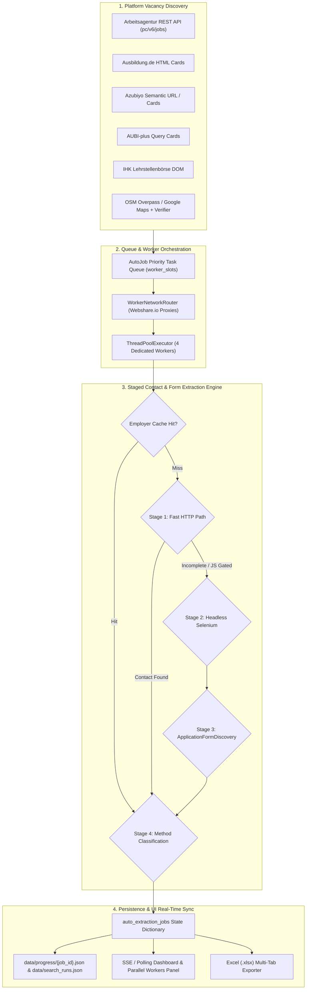

# JobScout — Complete Email & Application Form Extraction Architecture Audit
## Executive Summary & System Overview

> **Audit Type:** Technical Architecture, Code Audit & Extraction Pipeline Verification  
> **Target System:** JobScout Core Scraper, Auto-Extraction Queue, Worker Manager, and Contact Extraction Engine  
> **Status:** Current Production Version (Investigation & Audit Only — Code Preserved)

---

### 1. Executive Overview

JobScout operates an automated job discovery, verification, and recruitment contact extraction architecture designed to discover apprenticeships (*Ausbildungsplätze*) and jobs across Germany. The extraction system handles six primary source platforms:
1. **Bundesagentur für Arbeit (Arbeitsagentur)**
2. **Ausbildung.de**
3. **Azubiyo**
4. **AUBI-plus**
5. **IHK Lehrstellenbörse**
6. **Google Maps & Direct Employer Website Discovery (via OpenStreetMap Overpass & Places)**

The core value proposition of JobScout is transforming raw vacancy search results into **actionable Bewerbung intelligence**—specifically finding direct HR recruitment email addresses, active online application forms, and applicant tracking system (ATS) portals, while discarding spam, general support mailboxes, and deceptive portal redirect loops.

---

### 2. High-Level Extraction Architecture

The extraction pipeline follows a staged, fail-fast, fallback-oriented architecture orchestrated across concurrent background workers:

---

### 3. Key Findings Across the Architecture

1. **Dual Extraction Strategy (Fast-Path vs. Selenium):**
   - **Fast-Path HTTP:** Leverages lightweight `requests.Session` (timeout 5s) to parse vacancy HTML, meta tags, and SSR JSON scripts (`<script id="__NEXT_DATA__">`, Angular state scripts). If an email is found and verified, execution halts early, saving ~15 seconds per job (`scraper/working_email_extractor.py:437-510`).
   - **Selenium Fallback:** Launched on-demand when Fast-Path yields no direct contact, encounters JavaScript gating, requires cookie banner dismissal, or needs active DOM traversal for application buttons (`scraper/working_email_extractor.py:530-720`).

2. **Network Isolation & Proxy Security:**
   - Proxies are provisioned via the Webshare.io API (`services/worker_network_router.py:50-160`) assigning four distinct, pre-verified public egress IPs to Workers 1–4.
   - Enforces **fail-closed** network isolation: when `WORKER_REQUIRE_PROXIES=true`, direct fallback is strictly blocked to eliminate worker deanonymization. Credentials are automatically stripped from all logs and API payloads.

3. **Session & Run Isolation:**
   - Search runs are assigned an immutable `search_run_id` (e.g. `run_f5e0b67c`).
   - Auto-extraction queues, active worker telemetry, and disk checkpoints are scoped to their originating search run ID, preventing race conditions or cross-session data contamination (`app.py:2775-2920`).

4. **Application Form & ATS Intelligence:**
   - `scraper/application_form_discovery.py:48-115` maintains an index of 30+ ATS signatures (Personio, Workday, Softgarden, Recruitee, Greenhouse, SAP SuccessFactors, d.vinci, etc.).
   - Recognizes multi-lingual apply buttons (`Jetzt bewerben`, `Online-Bewerbung`, `Apply now`) and distinguishes actual job application inputs (`input[type=file]`, salary, resume fields) from generic customer support forms.

5. **Contact Method Classification:**
   - Vacancies are categorized into 8 deterministic states: `direct_email`, `recruitment_email`, `form`, `external_link`, `both`, `portal`, `manual_required`, and `none`.
   - Classification governs user options (e.g. enabling instant PDF cover letter generation for email-ready vacancies).

---

### 4. Overview of Audit Documents

The complete audit is organized into dedicated technical reports:

| Document | Title | Scope |
|---|---|---|
| [`01_ARBEITSAGENTUR.md`](file:///c:/Users/provincesettat/Desktop/ftr/pro-main/docs/extraction_audit/01_ARBEITSAGENTUR.md) | Arbeitsagentur Audit | REST API v6, 4-stage extractor, SSR Angular data, partner redirects |
| [`02_AUSBILDUNG_DE.md`](file:///c:/Users/provincesettat/Desktop/ftr/pro-main/docs/extraction_audit/02_AUSBILDUNG_DE.md) | Ausbildung.de Audit | DOM card parsing, tracking link resolution, ATS redirection |
| [`03_AZUBIYO.md`](file:///c:/Users/provincesettat/Desktop/ftr/pro-main/docs/extraction_audit/03_AZUBIYO.md) | Azubiyo Audit | Semantic profession slug routing, card scraping, ATS endpoints |
| [`04_AUBI_PLUS.md`](file:///c:/Users/provincesettat/Desktop/ftr/pro-main/docs/extraction_audit/04_AUBI_PLUS.md) | AUBI-plus Audit | Query structures, location matching, external application redirection |
| [`05_IHK.md`](file:///c:/Users/provincesettat/Desktop/ftr/pro-main/docs/extraction_audit/05_IHK.md) | IHK Lehrstellenbörse | Chamber of Commerce directory listings, detail parsing, contact patterns |
| [`06_GOOGLE_MAPS.md`](file:///c:/Users/provincesettat/Desktop/ftr/pro-main/docs/extraction_audit/06_GOOGLE_MAPS.md) | Google Maps & Discovery | OSM Overpass bbox querying, Maps crawler, website career verifier |
| [`07_SHARED_EXTRACTION_ENGINE.md`](file:///c:/Users/provincesettat/Desktop/ftr/pro-main/docs/extraction_audit/07_SHARED_EXTRACTION_ENGINE.md) | Shared Extraction Engine | `WorkingEmailExtractor` execution pipeline, cache keying, fast HTTP |
| [`08_EMAIL_EXTRACTION.md`](file:///c:/Users/provincesettat/Desktop/ftr/pro-main/docs/extraction_audit/08_EMAIL_EXTRACTION.md) | Email Extraction Logic | Regexes, Cloudflare email decoding, portal domain exclusion, validation |
| [`09_APPLICATION_FORM_DISCOVERY.md`](file:///c:/Users/provincesettat/Desktop/ftr/pro-main/docs/extraction_audit/09_APPLICATION_FORM_DISCOVERY.md) | Application Form Discovery | `ApplicationFormDiscovery`, ATS heuristics, DOM input inspections |
| [`10_WORKERS_AND_QUEUE.md`](file:///c:/Users/provincesettat/Desktop/ftr/pro-main/docs/extraction_audit/10_WORKERS_AND_QUEUE.md) | Workers, Proxies & Queue | ThreadPoolExecutor, slot queue, Webshare routing, Pause/Resume |
| [`11_DATA_FLOW_AND_STORAGE.md`](file:///c:/Users/provincesettat/Desktop/ftr/pro-main/docs/extraction_audit/11_DATA_FLOW_AND_STORAGE.md) | Data Flow & Storage | State mutation, progress persistence, disk storage, Excel output |
| [`12_METRICS_AND_ACCURACY.md`](file:///c:/Users/provincesettat/Desktop/ftr/pro-main/docs/extraction_audit/12_METRICS_AND_ACCURACY.md) | Metrics & Accuracy | Counter analysis, attempts vs. verified, idempotency, edge cases |
| [`13_PLATFORM_COMPARISON.md`](file:///c:/Users/provincesettat/Desktop/ftr/pro-main/docs/extraction_audit/13_PLATFORM_COMPARISON.md) | Platform Comparison | Cross-platform capability matrix with implementation status |
| [`14_CONFIRMED_ISSUES.md`](file:///c:/Users/provincesettat/Desktop/ftr/pro-main/docs/extraction_audit/14_CONFIRMED_ISSUES.md) | Confirmed Issues | Top 10 confirmed bugs and architecture limitations with citations |
| [`15_IMPROVEMENT_ROADMAP.md`](file:///c:/Users/provincesettat/Desktop/ftr/pro-main/docs/extraction_audit/15_IMPROVEMENT_ROADMAP.md) | Improvement Roadmap | Prioritized engineering enhancements (P0 through P3) |
| [`COMPLETE_EXTRACTION_REPORT.md`](file:///c:/Users/provincesettat/Desktop/ftr/pro-main/docs/extraction_audit/COMPLETE_EXTRACTION_REPORT.md) | Master Audit Report | Consolidated, all-in-one comprehensive technical audit |
