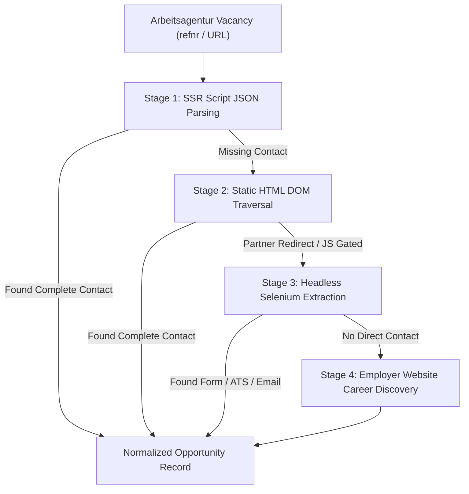

# Platform Extraction Audit — 01: Bundesagentur für Arbeit (Arbeitsagentur)

> **Platform Key:** `arbeitsagentur`  
> **Primary Source Files:** `scraper/enhanced_api_scraper.py`, `scraper/arbeitsagentur_extractor.py`, `scraper/working_email_extractor.py`  
> **Implementation Status:** `Implemented` (High Maturity)

---

### 1. Discovery Architecture

#### A. Entry Points & Endpoints
- **File:** [`scraper/enhanced_api_scraper.py`](file:///c:/Users/provincesettat/Desktop/ftr/pro-main/scraper/enhanced_api_scraper.py#L12-L135)
- **API Endpoint:** `https://rest.arbeitsagentur.de/jobboerse/jobsuche-service/pc/v6/jobs`
- **HTTP Method:** `GET`
- **Headers Required:**
  ```python
  # scraper/enhanced_api_scraper.py:21-32
  {
      "User-Agent": "JobScout/2.0 (Windows NT 10.0; Win64; x64) AppleWebKit/537.36",
      "X-API-Key": "jobboerse-jobsuche",
      "Accept": "application/json"
  }
  ```
- **Query Parameters:**
  - `was`: URL-encoded profession keyword (e.g. `Hotelfachmann`)
  - `wo`: URL-encoded location or postal code
  - `umkreis`: Radius in kilometers (default: `25`)
  - `angebotsart`: `4` (strictly restricts results to apprenticeships / *Ausbildung*)
  - `page`: 1-based page index
  - `size`: Page batch size (default: `100`, max permitted by BA API)

#### B. Vacancy Ingestion & Normalization
- Vacancies are extracted from JSON payload attribute `stellenangebote`.
- Preserved fields include: `refnr`, `titel`, `arbeitgeber`, `arbeitsort`, `eintrittsdatum`, and `modifikationsTimestamp`.
- A canonical detail URL is formed:  
  `https://www.arbeitsagentur.de/jobsuche/jobdetail/{refnr}`.
- Original platform identifier is tagged as `"source": "arbeitsagentur"`.

---

### 2. Contact & Application Extraction Pipeline

The detail extraction for Arbeitsagentur is implemented in [`scraper/arbeitsagentur_extractor.py`](file:///c:/Users/provincesettat/Desktop/ftr/pro-main/scraper/arbeitsagentur_extractor.py#L121-L710) via class `ArbeitsagenturDetailExtractor`. It employs a 4-stage pipeline:



#### A. Stage 1: SSR Script Data Extraction (`extract_from_ssr_script`)
- **Location:** `scraper/arbeitsagentur_extractor.py:149-178`
- BA uses Angular Universal Server-Side Rendering. The raw job payload is embedded directly within `<script type="application/json" id="job-data">` or `window.__INITIAL_STATE__`.
- The extractor parses this JSON directly without DOM rendering:
  - Extracts `bewerbungsemail` or nested `kontakte[].email`
  - Extracts `bewerbungsUrl` (external ATS or application portal link)
  - Extracts contact person (`ansprechpartner`), telephone, and postal address

#### B. Stage 2: HTML DOM Traversal (`parse_application_section`)
- **Location:** `scraper/arbeitsagentur_extractor.py:180-425`
- Evaluates application methods indicated in BA metadata:
  - `bewerbungsarten`: Look for `SCHRIFTLICH`, `INTERNET`, `EMAIL`
  - Inspects CSS selector `div[data-testid="bewerbung-detail"]` and `.bewerbung-kontakt`
  - Extracts `mailto:` links and runs regex matching: `[a-zA-Z0-9._%+-]+@[a-zA-Z0-9.-]+\.[a-zA-Z]{2,}`
  - Filters out Bundesagentur internal emails (e.g. `...@arbeitsagentur.de`)

#### C. Stage 3: Selenium Headless Fallback (`extract_with_selenium`)
- **Location:** `scraper/arbeitsagentur_extractor.py:428-568`
- Triggered when:
  1. The vacancy is hosted by a BA partner portal (e.g. `stellenanzeigen.de`, `stepstone.de`, `arbeitsagentur.de/partner`) requiring JavaScript execution to reveal the outbound link.
  2. The application details are collapsed behind dynamic interactive tabs (`Bewerbung starten`, `Jetzt bewerben`).
- Workflow:
  - Dismisses the cookie dialog (`#onetrust-accept-btn-handler`).
  - Waits up to 10 seconds for Angular hydration (`EC.presence_of_element_located((By.CSS_SELECTOR, "div.job-detail"))`).
  - Clicks `button[data-testid="bewerbung-button"]` or follows outbound redirects to retrieve the real employer ATS destination.

#### D. Stage 4: Employer Website Fallback (`discover_employer_website_fallback`)
- **Location:** `scraper/arbeitsagentur_extractor.py:571-642`
- If BA yields only an employer name and address without direct contact details, the extractor triggers an automated search query to find the employer's homepage, followed by an Impressum and career page crawl.

---

### 3. Application Method Classification Matrix

Based on extracted fields, `classify_application_method` (`scraper/application_form_discovery.py:602-642`) maps BA jobs to:

| Condition | Classified Method | Actionable in UI |
|---|---|---|
| Valid recruitment email present, no form | `recruitment_email` / `direct_email` | Yes (Email & Instant Anschreiben) |
| Active online form detected (`<form>` inputs) | `form` | Yes (Autofill Queue) |
| Direct outbound ATS URL (Personio, etc.) | `external_link` | Yes (Direct Link to Portal) |
| Both verified email and external form URL | `both` | Yes (User Choice) |
| Redirect stays within Arbeitsagentur portal | `portal` | Neutral (Requires BA Login) |
| No email and no valid apply URL found | `none` | Marked for manual review |
| CAPTCHA or Cloudflare protection encountered | `manual_required` | User notification in Dashboard |

---

### 4. Verified Limitations & Edge Cases

1. **Partner Portal Masking (`arbeitsagentur.de/partner`):**
   - Certain BA vacancies originate from private job boards (e.g. StepStone, Monster). BA masks the actual apply link behind a tracking redirect. If the partner site serves an anti-bot challenge or requires user registration, Stage 3 may timeout and return `extraction_status: "redirect_unresolved"`.
2. **Generic BA Agentur Emails:**
   - Some BA listings list the agentur's own contact (`settat.arbeitsservice@arbeitsagentur.de`) instead of the employer's HR. While excluded by `PORTAL_EXCLUDED_EMAILS`, this occasionally results in `0` emails found when no fallback employer website search succeeds.
