# Platform Extraction Audit — 02: Ausbildung.de

> **Platform Key:** `ausbildung_de`  
> **Primary Source Files:** `scraper/ausbildung_de_scraper.py`, `scraper/working_email_extractor.py`, `scraper/application_form_discovery.py`  
> **Implementation Status:** `Implemented` (High Maturity)

---

### 1. Discovery Architecture

#### A. Entry Points & URL Construction
- **File:** [`scraper/ausbildung_de_scraper.py`](file:///c:/Users/provincesettat/Desktop/ftr/pro-main/scraper/ausbildung_de_scraper.py#L14-L135)
- **Base Search URL:** `https://www.ausbildung.de/suche/`
- **HTTP Method:** `GET`
- **Request Parameters:**
  - `search`: Keyword string (e.g. `Fachinformatiker`)
  - `location`: German city or region (e.g. `Frankfurt am Main`)
  - `radius`: Distance radius in km (default `25`)
  - `page`: 1-based pagination index
- **Headers:** Includes rotating modern Desktop Chrome User-Agents and standard browser headers.

#### B. Card Parsing & Extraction
- **Function:** `_parse_cards` (`scraper/ausbildung_de_scraper.py:136-215`)
- Targets card elements matching `article[data-testid="jp-card"]` or `.job-card`.
- Discovered attributes:
  - `title`: Extracted from card heading (`h3`, `h2`, or `.card-title`)
  - `company`: Extracted from `.company-name` or `span[data-testid="company-name"]`
  - `location`: Extracted from card metadata badge
  - `url`: Canonical relative URL expanded with `https://www.ausbildung.de`
  - `source`: Tagged as `"ausbildung_de"`

---

### 2. Email & Application Form Extraction

Ausbildung.de listings almost never display raw recruiter emails on search results; they redirect applicants either to:
1. Ausbildung.de's own embedded 1-click application form, or
2. The employer's corporate ATS / career portal (via a tracking redirect: `/stellenanzeigen/redirect/...`).

```mermaid
flowchart TD
    Card["Ausbildung.de Card"] --> DetailPage["Vacancy Detail Page"]
    DetailPage --> FastHTTP{"Fast HTTP Check"}
    FastHTTP -- Embedded mailto found --> EmailExtracted["Recruitment Email Saved"]
    FastHTTP -- Outbound tracking redirect --> FollowRedirect["Follow Redirect via Session/Selenium"]
    FollowRedirect --> DestDomain{"Destination Domain"}
    DestDomain -- Known ATS (Personio, Workday) --> ATSFound["Record as external_link (ATS)"]
    DestDomain -- Employer Career Form --> DOMInspect["Inspect <form> Inputs"]
    DOMInspect -- Has File Upload / Submit --> FormFound["Record as form"]
    DestDomain -- Employer Static Site --> ImpressumCrawler["Crawl Impressum & Contact Page"]
    ImpressumCrawler --> ExtractedContact["Generic/Recruiter Email"]
```

#### A. Fast-Path HTTP Extraction
- **Implementation:** `scraper/working_email_extractor.py:437-510`
- Fetches the vacancy detail page via `requests.Session`.
- Looks for JSON-LD structured data (`<script type="application/ld+json">` with `@type: "JobPosting"`):
  - Ingests `hiringOrganization`, `employmentType`, `jobLocation`.
  - Searches for `directApply: true` or `applicationContact.email`.

#### B. Following Outbound Application Redirects
- **Implementation:** `scraper/application_form_discovery.py:371-440`
- Ausbildung.de buttons (`Jetzt bewerben`, `Zur Bewerbung`) point to URLs such as `https://www.ausbildung.de/stellenanzeigen/click/...`.
- The engine executes HTTP `HEAD` or `GET` with redirect tracking (`allow_redirects=True`, up to 5 hops).
- Resolves the terminal URL to detect if it lands on an ATS (`KNOWN_ATS_DOMAINS` like `recruitee.com`, `personio.de`, `talention.com`).

#### C. Impressum & Company Contact Crawling
- If no direct recruitment email is in the listing, `scraper/impressum_extractor.py` and `scraper/working_email_extractor.py:370-391` execute:
  1. Root domain resolution (`urlparse(terminal_url).netloc`).
  2. Targeted requests to `/impressum`, `/kontakt`, `/karriere/kontakt`.
  3. Strict email validation: prioritizes `karriere@`, `bewerbung@`, `jobs@` over `info@` and `datenschutz@`.

---

### 3. Application Method Classification

- If outbound URL matches `is_known_ats_url()`: `application_method = "external_link"`, `has_form = True`.
- If destination page has `<form>` with `enctype="multipart/form-data"` or `input[type=file]`: `application_method = "form"`.
- If an email is retrieved from the listing or career section: `application_method = "recruitment_email"`.
- If both exist: `application_method = "both"`.

---

### 4. Verified Limitations & Edge Cases

1. **Tracking Redirect JavaScript Timers:**
   - Some Ausbildung.de links render an intermediate HTML redirect page (`<meta http-equiv="refresh" ...>`) or execute `window.location.replace()`. In Fast-Path HTTP, `requests.get()` will not execute JS, leaving the raw redirect URL as the target unless Selenium takes over.
2. **Partner Network Listings:**
   - Sponsored ads from third-party aggregators embedded in Ausbildung.de search results occasionally point to aggregators (e.g. Jobbörse.de) rather than the direct employer, causing multi-hop redirect depth limits to trigger.
