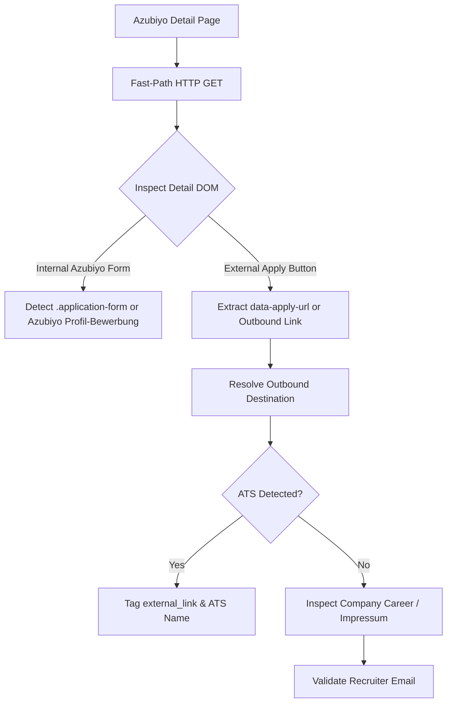

# Platform Extraction Audit — 03: Azubiyo

> **Platform Key:** `azubiyo`  
> **Primary Source Files:** `scraper/azubiyo_scraper.py`, `scraper/working_email_extractor.py`, `scraper/application_form_discovery.py`  
> **Implementation Status:** `Implemented` (High Maturity)

---

### 1. Discovery Architecture

#### A. Entry Points & Semantic Slug Resolution
- **File:** [`scraper/azubiyo_scraper.py`](file:///c:/Users/provincesettat/Desktop/ftr/pro-main/scraper/azubiyo_scraper.py#L23-L125)
- Azubiyo utilizes human-readable, SEO-optimized URL paths rather than query strings.
- **Slug Resolver:** `_resolve_profession_slug` and `PROFESSION_SLUG_MAP` (`scraper/azubiyo_scraper.py:28-56`):
  ```python
  PROFESSION_SLUG_MAP = {
      "fachinformatiker": "fachinformatiker",
      "fachinformatiker anwendungsentwicklung": "fachinformatiker-anwendungsentwicklung",
      "fachinformatiker systemintegration": "fachinformatiker-systemintegration",
      "industriekaufmann": "industriekaufmann",
      "kaufmann fuer bueromanagement": "kaufmann-bueromanagement",
      "hotelfachmann": "hotelfachmann",
      ...
  }
  ```
- **Candidate URL Generator (`build_candidate_urls`):**
  - Path 1: `https://www.azubiyo.de/ausbildung/{profession_slug}/{city_slug}/`
  - Path 2: `https://www.azubiyo.de/ausbildung/{profession_slug}/`
  - Path 3: `https://www.azubiyo.de/stellenangebote/?q={keyword}&ort={location}`

#### B. HTML Card Parsing
- **Function:** `_parse_cards` (`scraper/azubiyo_scraper.py:207-270`)
- Selects DOM cards matching `.offer-card`, `.result-card`, or `article.job-ad`.
- Extracts:
  - `title`: Extracted from `h3.offer-card__title`
  - `company`: Extracted from `.offer-card__company`
  - `location`: Extracted from `.offer-card__location`
  - `url`: `https://www.azubiyo.de` + anchor `href`
  - `source`: Tagged as `"azubiyo"`

---

### 2. Email & Application Form Extraction



#### A. Detail Page Parsing
- Azubiyo offers two primary application mechanisms:
  1. **Azubiyo Profil-Bewerbung:** A built-in portal application form where students apply using an Azubiyo account.
  2. **Direkt zur Bewerbung (External Button):** A button with attributes like `data-tracking="apply-button"` or `href="/stellenanzeigen/externer-link/..."`.

#### B. ATS & External Form Discovery
- `ApplicationFormDiscovery.discover_application_form` checks the outbound link.
- Known corporate ATS partners integrated on Azubiyo include:
  - d.vinci (`dvinci-hr.com`)
  - Workday (`myworkdayjobs.com`)
  - Rexx Systems (`rexx-recruitment.com`)
  - softgarden (`softgarden.io`)
- When an outbound ATS link is verified, `direct_application_url` is stored, and `has_form` is set to `True`.

#### C. Direct Email Extraction
- In listings where an employer provides contact information (often in a sidebar `<aside class="contact-box">`), the extractor retrieves the recruiter's name, email, and phone number (`scraper/working_email_extractor.py:370-390`).

---

### 3. Application Method Classification

- **`recruitment_email`**: Found in contact box or company Impressum.
- **`form`**: Direct online application form on employer site.
- **`external_link`**: Outbound link to ATS or career portal.
- **`portal`**: Vacancy allows application exclusively through internal Azubiyo registration.
- **`both`**: Contact email available alongside an external application link.

---

### 4. Verified Limitations & Edge Cases

1. **Azubiyo Internal Gate:**
   - Some Azubiyo vacancies disable external links completely and mandate that users register an Azubiyo account to submit an application. In these cases, JobScout cannot extract an external URL or direct recruiter email, correctly categorizing the job as `portal`.
2. **Slug Mismatch on Niche Professions:**
   - If a user enters an unmapped composite keyword (e.g. `Kaufmann für Digitalisierungsmanagement im E-Commerce`), `_resolve_profession_slug` falls back to general search query strings, which sometimes yield broader results with lower relevance.
