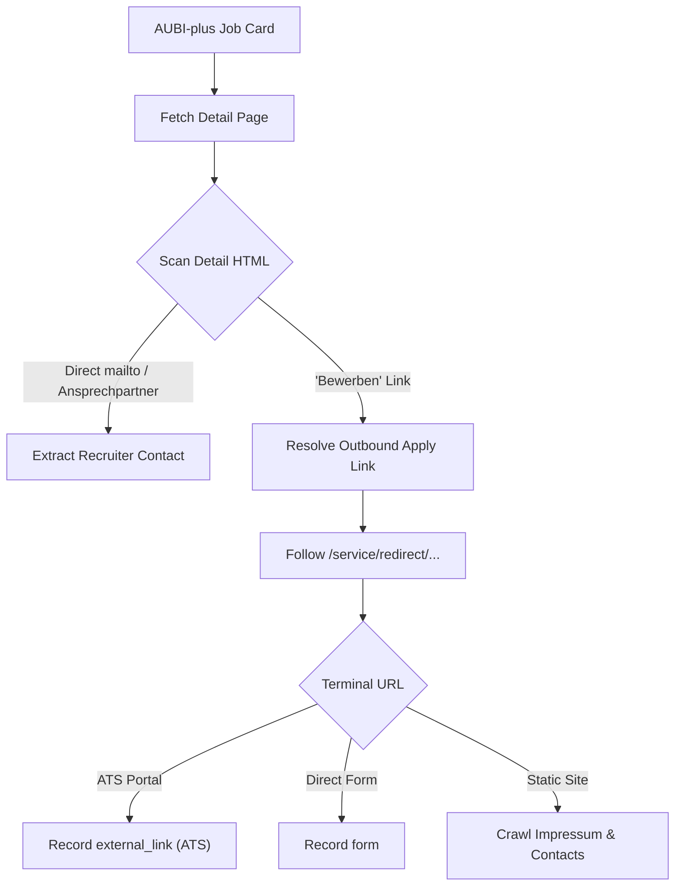

# Platform Extraction Audit — 04: AUBI-plus

> **Platform Key:** `aubi_plus`  
> **Primary Source Files:** `scraper/aubi_plus_scraper.py`, `scraper/working_email_extractor.py`, `scraper/application_form_discovery.py`  
> **Implementation Status:** `Implemented` (High Maturity)

---

### 1. Discovery Architecture

#### A. Entry Points & Query Structure
- **File:** [`scraper/aubi_plus_scraper.py`](file:///c:/Users/provincesettat/Desktop/ftr/pro-main/scraper/aubi_plus_scraper.py#L14-L140)
- **Search URL:** `https://www.aubi-plus.de/suchergebnisse/`
- **HTTP Method:** `GET`
- **Request Parameters:**
  - `suchbegriff`: Profession query string (e.g. `Mechatroniker`)
  - `ort`: Location string or postal code
  - `umkreis`: Radius (default `25` or Bundesweit)
  - `seite`: Page number for pagination
  - `angebotsart`: `1` (Dual Apprenticeships / *Duale Ausbildung*)
- **Headers:** Desktop Chrome user agent with language preference `de-DE,de;q=0.9`.

#### B. Location Strictness & Card Parsing
- **Function:** `_parse_cards` & `_is_location_match` (`scraper/aubi_plus_scraper.py:164-230`, `306-385`)
- AUBI-plus often displays sponsored national listings even when a local city filter is requested.
- **Strict Location Matcher (`_is_location_match`):**
  - Compares vacancy location against the user's target city. If a non-Bundesweit search was requested, non-matching national sponsored ads are filtered out to prevent polluted search datasets.
- Discovered fields: `title`, `company`, `location`, `url`, `source` (`"aubi_plus"`).

---

### 2. Email & Application Form Extraction

#### A. Fast-Path Detail Inspection
- AUBI-plus detail pages (`https://www.aubi-plus.de/ausbildung/{job_id}/...`) frequently contain an explicit **Ansprechpartner** contact box:
  - Selectors: `.contact-person`, `.ansprechpartner`, `.detail-sidebar`
  - Contains recruiter name, direct email, and phone number.
  - Parsed by Fast-Path HTTP in `< 1` second without Selenium.

#### B. Application Link Resolution (`/service/redirect/`)
- AUBI-plus wraps outbound employer links in tracking redirects (`/service/redirect/?url=...` or base64-encoded URL parameters).
- `scraper/aubi_plus_scraper.py` and `ApplicationFormDiscovery` unwrap these links:
  - If URL parameter contains `url=http...`, it is decoded immediately without a network round-trip.
  - If obfuscated, the HTTP client issues a `HEAD` request to capture the `Location` redirect header.

#### C. Form & ATS Identification
- Inspects the landing page for known ATS domains (`recruitee`, `personio`, `dvinci`, etc.) or embedded application forms (`<form id="bewerbung">`).

---

### 3. Application Method Classification

- **`direct_email` / `recruitment_email`**: Recruiter email found in the AUBI-plus sidebar contact box or company site.
- **`external_link`**: Outbound link redirecting to the employer's career page or ATS.
- **`form`**: Landing page contains active input fields for CV and cover letter submission.
- **`both`**: Both a direct contact person email and an online application URL are available.

---

### 4. Verified Limitations & Edge Cases

1. **Redirect Obfuscation via Client-Side JavaScript:**
   - In rare cases, AUBI-plus uses an encrypted token in the redirect URL that is only resolved when client JavaScript sends an AJAX beacon. Fast-Path HTTP cannot decrypt this token, necessitating Selenium fallback.
2. **Aggregated Chamber Data:**
   - Some AUBI-plus postings are mirror feeds from regional chambers (IHK/HWK) where the apply link points back to a chamber overview page rather than the company's direct application form.
