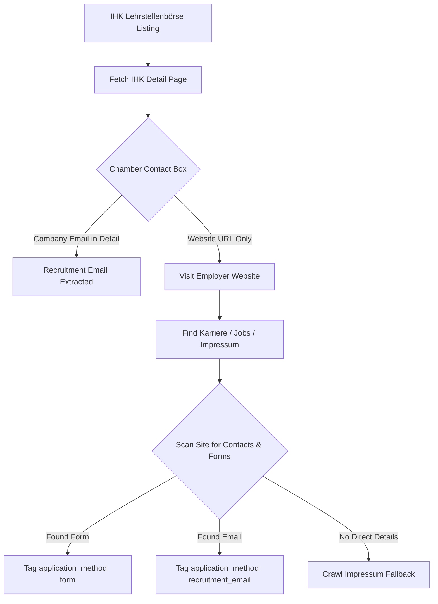

# Platform Extraction Audit — 05: IHK Lehrstellenbörse

> **Platform Key:** `ihk`  
> **Primary Source Files:** `scraper/ihk_scraper.py`, `scraper/working_email_extractor.py`, `scraper/application_form_discovery.py`  
> **Implementation Status:** `Implemented` (High Maturity)

---

### 1. Discovery Architecture

#### A. Entry Points & Endpoints
- **File:** [`scraper/ihk_scraper.py`](file:///c:/Users/provincesettat/Desktop/ftr/pro-main/scraper/ihk_scraper.py#L14-L135)
- **Base URL:** `https://www.ihk-lehrstellenboerse.de/suche/`
- **HTTP Method:** `GET`
- **Request Parameters:**
  - `beruf`: Profession name (e.g. `Industriemechaniker`)
  - `ort`: City or postal code
  - `umkreis`: Radius in kilometers (e.g. `50`)
  - `page`: Pagination index
- **Headers:** Standard browser headers with `Accept: text/html,application/xhtml+xml`.

#### B. Parsing Chamber Postings
- **Function:** `_parse_cards` (`scraper/ihk_scraper.py:124-185`)
- IHK Lehrstellenbörse is maintained by the Association of German Chambers of Commerce and Industry (DIHK).
- Listings are verified chamber apprenticeship openings.
- Extracts:
  - `title`: Extracted from `.result-item__title` or `h3`
  - `company`: Extracted from `.result-item__company`
  - `location`: Extracted from `.result-item__location`
  - `url`: Relative link converted to `https://www.ihk-lehrstellenboerse.de/...`
  - `source`: Tagged as `"ihk"`

---

### 2. Email & Contact Extraction Pipeline

#### A. Detail Page Parsing
- IHK listings contain a standardized structured information panel:
  - **Ausbildungsbetrieb (Training Company):** Company legal name, physical address, and official website.
  - **Ansprechpartner (Contact Person):** Name of the training supervisor (*Ausbildungsleiter*), telephone number, and official application email address.
- Fast-Path HTTP parses these tables using BeautifulSoup, targeting elements like `.contact-person`, `a[href^="mailto:"]`, and `.company-contact`.

#### B. Direct Employer Website Discovery
- If the IHK entry contains the employer's homepage URL but omits the email:
  - The crawler executes `WorkingEmailExtractor.extract_contact_info(company_website)` (`scraper/working_email_extractor.py:370-391`).
  - Checks `/karriere`, `/ausbildung`, `/kontakt`, and `/impressum`.
  - Excludes IHK generic domain emails (`...@ihk.de`, `...@dihk.de`).

---

### 3. Application Method Classification

- **`recruitment_email`**: Recruiter or training supervisor email from the IHK contact block.
- **`form`**: Application form on the company's verified domain.
- **`external_link`**: Outbound link to the employer's careers site.
- **`none`**: Listing only offers postal contact (*Bewerbung per Post*), marked for manual review.

---

### 4. Verified Limitations & Edge Cases

1. **Postal-Only Applications (*Schriftliche Bewerbung*):**
   - Certain traditional craft or industrial SMEs registered with IHK explicitly specify postal submission only. In these cases, no email or online form exists; JobScout flags `application_method = "none"` with `manual_review_required = True`.
2. **Session / CSRF Cookies on Direct Detail URLs:**
   - IHK portal occasionally requires an initial session cookie before allowing access to individual vacancy detail pages. If requested without prior session initialization, it redirects to the search homepage. The scraper initializes a session on the search page before requesting detail URLs.
