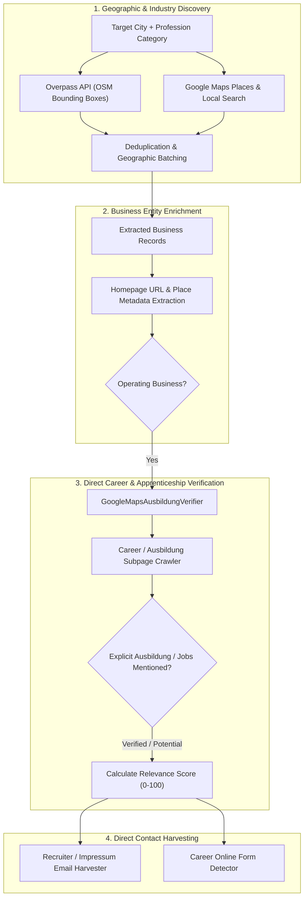

# Platform Extraction Audit — 06: Google Maps & Direct Employer Discovery

> **Platform Key:** `google_maps`  
> **Primary Source Files:** `scraper/google_maps_scraper.py`, `scraper/overpass_scraper.py`, `scraper/google_maps_ausbildung_verifier.py`, `services/nationwide_discovery_engine.py`  
> **Implementation Status:** `Implemented` (High Maturity)

---

### 1. Discovery Architecture

Unlike classic job portals which host pre-aggregated vacancy cards, the Google Maps & Direct Discovery engine uncovers **unadvertised and direct apprenticeship opportunities** by identifying relevant regional enterprises and auditing their corporate websites.



#### A. Entry Points & Tools
- **Files:**
  - [`scraper/overpass_scraper.py`](file:///c:/Users/provincesettat/Desktop/ftr/pro-main/scraper/overpass_scraper.py): Fast, non-rate-limited OpenStreetMap Overpass queries targeting industrial nodes/ways by OSM tag (`amenity`, `shop`, `craft`, `office`, `healthcare`).
  - [`scraper/google_maps_scraper.py`](file:///c:/Users/provincesettat/Desktop/ftr/pro-main/scraper/google_maps_scraper.py#L225-L1015): Headless Chrome crawler interacting with Google Maps search (`https://www.google.com/maps/search/...`).
  - [`scraper/google_maps_ausbildung_verifier.py`](file:///c:/Users/provincesettat/Desktop/ftr/pro-main/scraper/google_maps_ausbildung_verifier.py#L98-L635): Website verification crawler that validates apprenticeship readiness.

---

### 2. Website Crawling & Apprenticeship Verification

#### A. Career Link Discovery (`discover_career_links`)
- **Location:** `scraper/google_maps_ausbildung_verifier.py:148-189`
- Evaluates homepage HTML anchors against German career terms:
  ```python
  CAREER_KEYWORDS = [
      "karriere", "career", "jobs", "stellenangebote",
      "ausbildung", "azubi", "lehrstelle", "wir-suchen",
      "ueber-uns/karriere", "arbeiten-bei"
  ]
  ```
- Generates fully qualified URLs and crawls up to 5 prioritized candidate pages.

#### B. Verification of Active Apprenticeships (`check_page_for_ausbildung`)
- **Location:** `scraper/google_maps_ausbildung_verifier.py:191-250`
- Scans candidate pages for specific apprenticeship indicators:
  - Strong terms: `Ausbildung 2024/2025`, `Auszubildende gesucht`, `Duales Studium`, `IHK Ausbildungsbetrieb`.
  - Negative terms: `Keine offenen Stellen`, `Initiativbewerbungen nicht erwünscht`.
- Computes `verification_status`:
  - `"verified"`: Page explicitly lists open apprenticeship vacancies matching the keyword.
  - `"potential"`: Employer advertises general apprenticeships or actively accepts speculative applications (*Initiativbewerbung*).
  - `"unverified"`: No mention of apprenticeships found.

---

### 3. Contact & Application Method Extraction

- **Email Extraction (`scraper/google_maps_scraper.py:146-220`, `709-775`):**
  - Extracts direct `mailto:` links.
  - Decodes obfuscated emails (e.g. Cloudflare email protection via `_decode_cloudflare_email`).
  - De-obfuscates text patterns like `info [at] domain.de` or `kontakt(at)domain.de`.
  - Scans `/impressum` and `/kontakt` when career pages lack direct contact.
- **Form Detection (`ApplicationFormDiscovery`):**
  - Detects if the employer's career page hosts an active form or links out to an external ATS.

---

### 4. Verified Limitations & Edge Cases

1. **Anti-Scraping Interstitials on Google Maps:**
   - Rapid querying of Google Maps can trigger consent modals (`Before you continue to Google Maps`) or reCAPTCHA v2. Handled via `_accept_cookies` (`scraper/google_maps_scraper.py:295-320`), but worker network routing through dedicated residential/datacenter Webshare proxies is mandatory to avoid IP blocks.
2. **Missing Corporate Websites:**
   - Roughly 10-15% of small local businesses listed on Maps have no website registered, or list only a social media page (e.g. Facebook / Instagram). These are marked as `unverified` and lack extractable recruitment forms.
