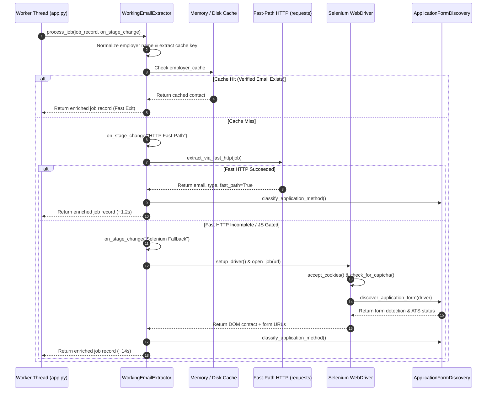

# Architecture Audit — 07: Shared Extraction Engine (`WorkingEmailExtractor`)

> **Primary Source File:** [`scraper/working_email_extractor.py`](file:///c:/Users/provincesettat/Desktop/ftr/pro-main/scraper/working_email_extractor.py)  
> **Core Class:** `WorkingEmailExtractor` (Lines 47–758)  
> **Implementation Status:** `Implemented` (High Maturity)

---

### 1. Engine Responsibilities

`WorkingEmailExtractor` is the primary orchestrator instantiated by each worker thread. It executes the staged extraction pipeline, coordinates fast-path HTTP checks, launches headless Selenium instances when required, detects and handles security challenges, and invokes `ApplicationFormDiscovery`.

---

### 2. Detailed Pipeline Stages

#### A. Cache Optimization & Keying (`_get_cache_key`)
- **Location:** `scraper/working_email_extractor.py:426-435`
- Generates a normalized cache key:  
  `cache_key = f"{normalized_employer}::{clean_domain}"`
- If an employer with 10 vacancies in the search has already been verified in the current run, subsequent jobs bypass network requests entirely.

#### B. Stage 1: Fast-Path HTTP (`extract_via_fast_http`)
- **Location:** `scraper/working_email_extractor.py:437-510`
- Utilizes an optimized `requests.Session` with a strict 5-second timeout and custom User-Agent.
- **Workflow:**
  1. For Arbeitsagentur vacancies, invokes `ArbeitsagenturDetailExtractor.extract_from_ssr_script` to read server-rendered JSON.
  2. For other portals, executes a `GET` request and parses HTML with BeautifulSoup.
  3. Scans for `mailto:` links, JSON-LD structured data, and `<meta>` tags.
  4. If a valid recruiter email is found, classifies the email and terminates execution immediately.

#### C. Stage 2: Selenium Fallback (`extract_via_selenium` / `open_job`)
- **Location:** `scraper/working_email_extractor.py:512-720`
- Configures a headless Chrome driver (`setup_driver:113-150`):
  - Injects anti-detection arguments (`--disable-blink-features=AutomationControlled`, realistic window size `1920,1080`).
  - Applies worker proxy profile via `services/worker_network_router.py`.
- **Execution:**
  1. Navigates to job URL with 15-second page-load timeout.
  2. Executes cookie banner dismissal via `cookie_handler.py`.
  3. Inspects DOM for CAPTCHA markers (`check_for_captcha:152-178`).
  4. Scans visible body text and contact elements for emails.
  5. If direct email is absent, invokes `extract_contact_info` on the employer's homepage/Impressum.

#### D. Stage 3: Form & ATS Discovery Integration
- Calls `ApplicationFormDiscovery.discover_application_form` passing the active Selenium driver.
- Traverses iframes, button clicks, and outbound ATS links.

---

### 3. Resource Management & Teardown

- Driver instances are maintained per worker thread and reused across sequential jobs to prevent Chrome process churn.
- Safe teardown via `close()` (`scraper/working_email_extractor.py:748-757`) ensures headless browser instances and proxy tunnels are terminated upon extraction completion or task cancellation.
