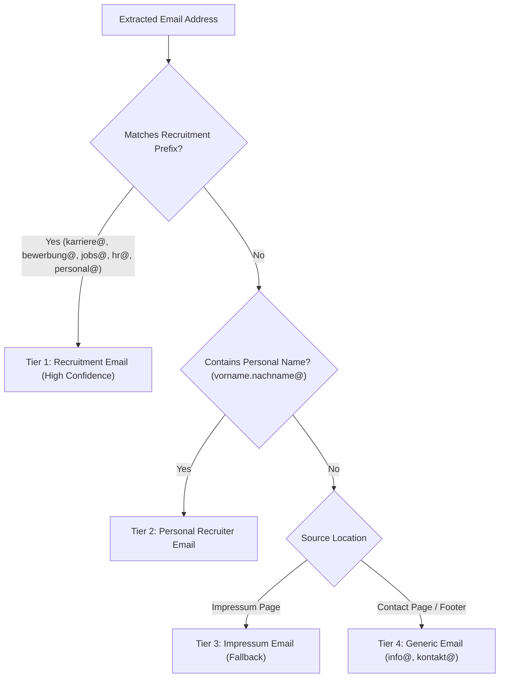

# Architecture Audit — 08: Email Extraction, Filtering & Validation Logic

> **Primary Source Files:** `scraper/working_email_extractor.py`, `scraper/google_maps_scraper.py`, `scraper/impressum_extractor.py`  
> **Implementation Status:** `Implemented` (High Maturity)

---

### 1. Extraction Mechanisms & Patterns

JobScout extracts email addresses through multiple independent layers:

#### A. Regex Pattern Matching
- **Standard Pattern:**
  ```python
  EMAIL_REGEX = r'[a-zA-Z0-9._%+-]+@[a-zA-Z0-9.-]+\.[a-zA-Z]{2,}'
  ```
- **Obfuscated Text Regex:**
  Handles anti-scraping obfuscations common on German websites:
  - `name (at) domain.de` -> `name@domain.de`
  - `name [at] domain [dot] de` -> `name@domain.de`
  - `name /at/ domain.de` -> `name@domain.de`
  - Implementation: `scraper/google_maps_scraper.py:130-144` (`_deobfuscate_email_text`).

#### B. Cloudflare Email Protection Decoding
- **Location:** `scraper/google_maps_scraper.py:120-128` (`_decode_cloudflare_email`)
- Websites protected by Cloudflare mask emails as `<a class="__cf_email__" data-cfemail="a8dcd... ">[email&#160;protected]</a>`.
- The engine extracts the hexadecimal string, XOR-decodes it against the key byte, and reconstructs the plaintext email without browser emulation.

---

### 2. Email Filtering & Discard Rules

To prevent polluting candidate application pipelines, extracted emails are evaluated against blacklists and heuristics:

#### A. Portal Exclusions (`PORTAL_EXCLUDED_EMAILS`)
Emails belonging to the job boards themselves or infrastructure providers are automatically discarded:
- `*@arbeitsagentur.de`, `*@ausbildung.de`, `*@azubiyo.de`, `*@aubi-plus.de`, `*@ihk.de`
- Common hosting/SaaS addresses: `support@wix.com`, `info@jimdo.com`, `abuse@cloudflare.com`

#### B. Syntax & TLD Validation
- **Location:** `scraper/google_maps_scraper.py:86-100` (`_is_valid_email`)
- Strips trailing punctuation (`.`, `,`, `:`, `;`).
- Discards image filenames mistakenly matched by regex (e.g. `image@2x.png`).
- Enforces valid TLD length (2 to 12 alphabetic characters).

---

### 3. Classification: Recruitment vs. Generic vs. Impressum

JobScout categorizes verified emails into confidence tiers:



1. **Recruitment Emails (`recruitment_email`):**
   - Prefixes: `bewerbung@`, `karriere@`, `jobs@`, `hr@`, `personal@`, `ausbildung@`, `recruiting@`.
   - Highest confidence; triggers primary action in UI for 1-click tailored email drafting.
2. **Personal Named Emails (`recruitment_email`):**
   - Matches named HR staff (e.g. `m.schmidt@firma.de`) discovered adjacent to "Ansprechpartner" or "Ausbildungsleiter".
3. **Impressum / Generic Emails (`direct_email`):**
   - Prefixes: `info@`, `kontakt@`, `zentrale@`, `office@`.
   - Used as secondary fallback when no direct HR address is published.
