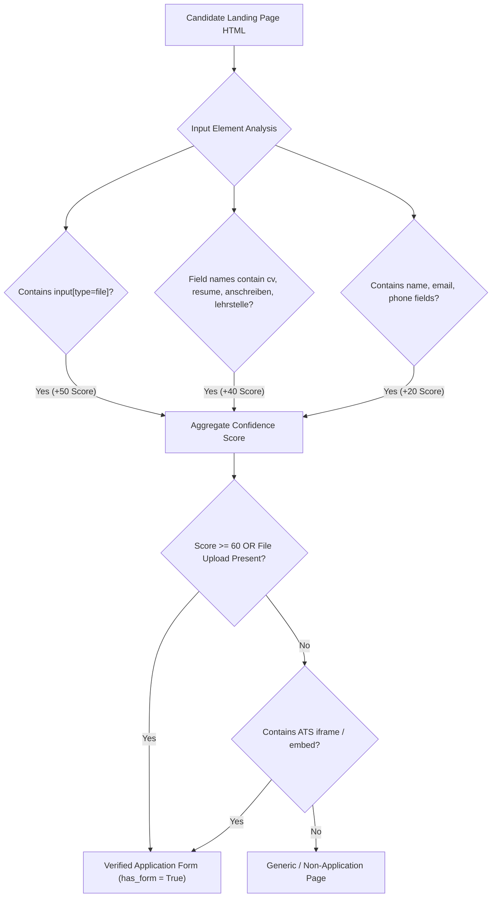

# Architecture Audit — 09: Application Form & ATS Discovery Engine

> **Primary Source File:** [`scraper/application_form_discovery.py`](file:///c:/Users/provincesettat/Desktop/ftr/pro-main/scraper/application_form_discovery.py)  
> **Core Class:** `ApplicationFormDiscovery` (Lines 181–642)  
> **Implementation Status:** `Implemented` (High Maturity)

---

### 1. Engine Overview

`ApplicationFormDiscovery` analyzes vacancy pages and employer websites to detect interactive online application forms and external Applicant Tracking Systems (ATS). It distinguishes real job application interfaces from generic contact forms, customer feedback forms, or newsletter signups.

---

### 2. Keyword & ATS Domain Indices

#### A. Button & Anchor Keywords (`APPLICATION_BUTTON_KEYWORDS`)
- **Location:** `scraper/application_form_discovery.py:48-77`
- Over 30 multi-lingual German/English application intent patterns:
  ```python
  APPLICATION_BUTTON_KEYWORDS = [
      "jetzt bewerben", "online bewerben", "hier bewerben",
      "direkt bewerben", "online-bewerbung", "bewerbung senden",
      "bewerbungsformular", "unterlagen einreichen", "bewerben",
      "apply now", "apply online", "submit application"
  ]
  ```

#### B. Known ATS Domains (`KNOWN_ATS_DOMAINS`)
- **Location:** `scraper/application_form_discovery.py:79-115`
- Detects outbound redirects to enterprise recruitment platforms:
  ```python
  KNOWN_ATS_DOMAINS = [
      "personio.de", "personio.net", "softgarden.io", "softgarden.de",
      "recruitee.com", "greenhouse.io", "lever.co", "workday.com",
      "myworkdayjobs.com", "dvinci-hr.com", "talention.com", "jobvite.com",
      "rexx-recruitment.com", "sap.com", "successfactors.com", "smartrecruiters.com"
  ]
  ```

---

### 3. Application Form Verification Heuristics

The method `verify_form_page` (`scraper/application_form_discovery.py:255-365`) analyzes the HTML DOM of candidate form pages:



1. **File Upload Verification:**
   - The presence of `<input type="file">` with attributes accepting `.pdf`, `.doc`, `.docx` provides immediate confirmation of an employment submission portal.
2. **Form Action & Method Inspection:**
   - Evaluates `<form action="..." method="POST" enctype="multipart/form-data">`.
3. **Embedded ATS Iframes:**
   - Scans for `<iframe>` tags pointing to external ATS hosts (e.g. `src="https://company.jobs.personio.de/..."`).

---

### 4. Classification Output

The method `classify_application_method` (`scraper/application_form_discovery.py:602-642`) synthesizes all indicators into deterministic tags:

- **`"form"`**: Direct application form verified on destination page.
- **`"external_link"`**: Outbound URL directs to a known ATS or career portal.
- **`"both"`**: Both a direct recruitment email and an online application URL exist.
- **`"portal"`**: Listing requires an account on the originating job portal.
- **`"direct_email"` / `"recruitment_email"`**: Email contact exists without an active form.
- **`"none"`**: No actionable digital submission channel discovered.
