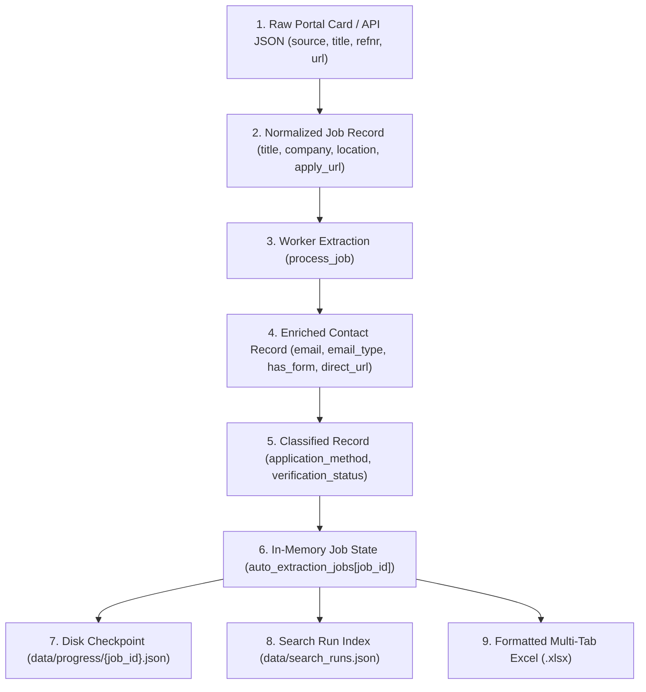

# Architecture Audit — 11: Data Flow, Checkpoints & Storage Lifecycle

> **Primary Source Files:** `app.py`, `scraper/working_email_extractor.py`, `static/spa/sections/search.js`  
> **Key Storage Locations:** `data/progress/{job_id}.json`, `data/search_runs.json`, `data/checkpoints/`  
> **Implementation Status:** `Implemented` (High Maturity)

---

### 1. Complete Data Transformation Lifecycle

Every vacancy record undergoes a deterministic multi-stage data transformation from initial search query to disk persistence:

---

### 2. State & Disk Persistence Mechanisms

#### A. In-Memory Thread-Safe State (`auto_extraction_jobs`)
- **Location:** `app.py:2775-3150`
- Access is strictly synchronized using `auto_extraction_jobs_lock` and `progress_lock`.
- Maintains real-time status, processed counters, worker states, and activity log feeds.

#### B. Checkpoint Persistence (`data/progress/{job_id}.json`)
- Updated periodically and upon task state changes (every job completion, pause, stop).
- Schema includes:
  - `job_id`, `search_run_id`, `keyword`, `location`, `total_jobs`
  - `current_index`, `processed_jobs`, `emails_found`, `forms_found`
  - `workers`: Current telemetry and counters for Workers 1–4
  - `jobs`: Full list of processed job dictionaries with extracted contacts

#### C. Search Session Isolation (`data/search_runs.json`)
- Associates each extraction run with a distinct `search_run_id`.
- Prevents cross-session data contamination between concurrent search queries.

---

### 3. Excel Multi-Tab Export (`/api/inline/auto-jobs/download/<job_id>`)

- Built via `openpyxl` / `pandas`.
- Generates categorized spreadsheets with dedicated sheets:
  - **Alle Stellen:** Master list of all discovered jobs.
  - **Mit E-Mail:** Jobs with direct recruiter email addresses ready for email outreach.
  - **Mit Online-Formular:** Jobs with verified ATS forms ready for automated form-filling.
  - **Manuelle Pruefung:** Jobs flagged for manual review due to CAPTCHA or missing digital channels.
