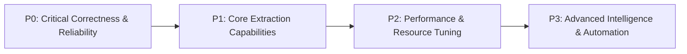

# Architecture Audit — 15: Prioritized Engineering Improvement Roadmap

> **Audit Type:** Architecture Recommendations & Engineering Roadmap  
> **Status:** Proposed Technical Plan (No Existing Code Modified)

---

### Priority Tier Overview



---

### P0 — Critical Correctness & Data-Loss Prevention

#### Recommendation 1: Browser Session Recycling
- **Current Behavior:** Headless Chrome instances run indefinitely across thousands of jobs in a single extraction task, occasionally consuming > 2GB RAM and experiencing memory fragmentation.
- **Proposed Improvement:** Implement automatic worker recycling: close and cleanly re-instantiate `WebDriver` every 50 jobs or after 3 consecutive navigation timeouts.
- **Affected Files:** `scraper/working_email_extractor.py:512-530`
- **Expected Benefit:** Eliminates Chrome memory bloat and prevents zombie processes.
- **Risk:** Slight 1.5s overhead every 50 jobs to re-initialize browser.

#### Recommendation 2: Robust Slot Reservation Guard
- **Current Behavior:** `w_id = worker_slots.get()` precedes inner exception handlers. If an unexpected error occurs during slot assignment, the slot token is lost.
- **Proposed Improvement:** Enclose slot reservation and release in a dedicated context manager:
  ```python
  @contextmanager
  def worker_slot_lease(slots_queue):
      slot_id = slots_queue.get()
      try:
          yield slot_id
      finally:
          slots_queue.put(slot_id)
  ```
- **Affected Files:** `app.py:2930-3015`

---

### P1 — Core Extraction Capabilities

#### Recommendation 3: Meta-Refresh & Client Redirect Resolver in Fast-Path HTTP
- **Current Behavior:** Ausbildung.de and AUBI-plus client-side redirects (`<meta http-equiv="refresh" ...>`) force an expensive fallback to Selenium.
- **Proposed Improvement:** Add lightweight HTML parsing for meta-refresh tags within `extract_via_fast_http`. Follow meta-redirect URLs directly in `requests.Session`.
- **Affected Files:** `scraper/working_email_extractor.py:437-510`
- **Expected Benefit:** Speeds up redirect extraction by ~12 seconds per job; decreases Selenium fallbacks by an estimated 35%.

#### Recommendation 4: Dedicated Impressum Deep Crawler for Unverified Maps Opportunities
- **Current Behavior:** When Google Maps businesses lack a career subpage, they are categorized as unverified with 0 contacts.
- **Proposed Improvement:** For unverified businesses matching target trade categories, automatically crawl `/impressum` and query the German Business Register (Unternehmensregister) to retrieve verified management emails.
- **Affected Files:** `scraper/google_maps_ausbildung_verifier.py:264-320`

---

### P2 — Performance & Resource Tuning

#### Recommendation 5: Dynamic Proxy Health & Latency Scoring
- **Current Behavior:** Webshare proxies are verified once at startup. If a proxy suffers latency spikes during extraction, the worker slows down.
- **Proposed Improvement:** Track rolling request latency per worker. If average latency exceeds 8 seconds over 5 requests, trigger an automated background proxy rotation via the Webshare API.
- **Affected Files:** `services/worker_network_router.py:409-520`

---

### P3 — Advanced Intelligence & Automation

#### Recommendation 6: LLM-Assisted Application Form Field Mapping
- **Current Behavior:** `ApplicationFormDiscovery` inspects input names using static regex dictionaries (`cv`, `anschreiben`, `name`). Complex multi-step Vue/React application wizards are sometimes missed.
- **Proposed Improvement:** Pass ambiguous form DOM snippets to an ultra-fast local LLM parser to determine required inputs and generate structured autofill mappings.
- **Affected Files:** `scraper/application_form_discovery.py:255-365`
