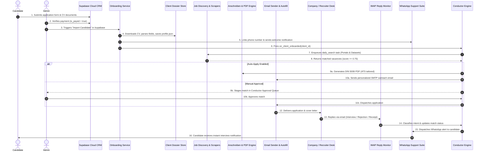
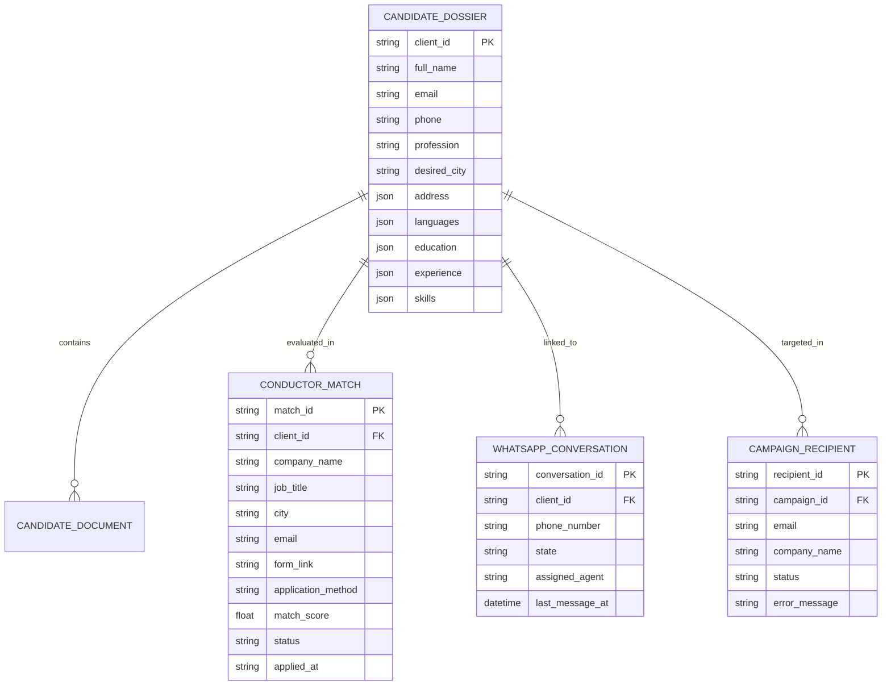
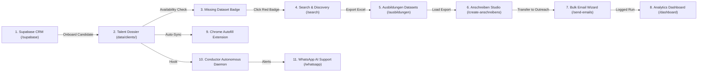

# JobScout — System Architecture & Inter-System Integrations

> **Document:** `ARCHITECTURE_AND_INTEGRATIONS.md`  
> **Platform Version:** 3.14  
> **Audit Date:** 2026-11-03  
> **Scope:** Full Architectural Mapping, Data Models, Inter-System Event Triggers, and Integration Health Analysis

---

## 1. System Communication Blueprint

The complete JobScout application workflow follows an 8-stage lifecycle from initial candidate intake to automated interview detection:

---

## 2. Shared Data Models & Storage Schemas

JobScout operates across five primary data layers: remote PostgreSQL (Supabase), four local SQLite3 databases, flat-file JSON registries, and document disk archives.

### 2.1 SQLite Databases Specification

#### 1. `data/conductor.db` (Multi-Agent Orchestrator)
- **`conductor_tasks`**: Background scheduler execution queue (`task_id`, `client_id`, `task_type`, `priority`, `status`, `retry_count`, `scheduled_at`, `payload`).
- **`client_automation_configs`**: Autonomous settings per candidate (`client_id`, `is_active`, `auto_apply`, `daily_application_limit`, `search_radius_km`, `preferred_sources`, `email_sender_profile`).
- **`client_matches`**: Job opportunities evaluated for each candidate (`id`, `client_id`, `company`, `title`, `city`, `email`, `score`, `status`: `discovered` | `staged_for_approval` | `applied` | `interview` | `rejected`).
- **`conductor_logs`**: System event journal (`id`, `level`, `component`, `message`, `timestamp`).

#### 2. `data/whatsapp.db` (Support & Webhook Hub)
- **`conversations`**: Active chat threads (`id`, `wa_id`, `client_id`, `profile_name`, `mode`: `ai` | `human`, `unread_count`, `last_activity`).
- **`messages`**: Inbound and outbound message history (`id`, `conversation_id`, `sender_type`: `client` | `ai` | `agent`, `text`, `timestamp`, `delivery_status`).
- **`knowledge_base`**: FAQ snippets and keywords (`id`, `trigger_patterns`, `question`, `answer`, `is_active`).
- **`audit_logs`**: Security audit log (`id`, `actor`, `action`, `details`, `timestamp`).

#### 3. `data/campaigns.db` (Bulk Outreach)
- **`campaigns`**: Batch outreach runs (`id`, `name`, `status`, `total_recipients`, `sent_success`, `failed_count`, `created_at`).
- **`recipients`**: Target inboxes (`id`, `campaign_id`, `email`, `company`, `subject`, `status`, `error`).

#### 4. `data/jobs.db` (Scraper Workers)
- **`background_jobs`**: Long-running scraper jobs (`id`, `job_type`, `status`, `progress`, `total`, `created_at`, `completed_at`).

### 2.2 Flat-File JSON Stores
- **`data/active_client.json`**: Current globally selected candidate ID for the active UI context (`{"active_client_id": "anass_sibbi"}`).
- **`data/ai_config.json`**: Active AI provider, model selections, and masked secret keys.
- **`data/ai_usage.json`**: Running ledger of input/output token counts and calculated financial costs by sub-system.
- **`data/ai_cache.json`**: SHA-256 hashed cache of completions preventing redundant LLM inference calls.
- **`data/ats_cache.json`**: Cache of keyword-tailored cover letter bullets and golden hooks.
- **`data/autofill_applications.json`**: Log of applications submitted via browser extension.
- **`data/onboarding_records.json`**: Idempotency ledger preventing duplicate Supabase candidate imports.

---

## 3. Cross-Page Actions & Inter-System Bridges

JobScout features multiple tightly coupled bridges that allow users to transition data between distinct subsystems with a single interaction:

### 3.1 Bridge 1: Supabase → Candidate Dossier (`handleOnboardCandidate`)
- **Trigger:** Administrator clicks "Import Candidate" in the candidate drawer on `/supabase`.
- **Payload:** Supabase `application_id`.
- **Action:** Downloads candidate documents from Supabase Storage buckets, executes `CVParser` to extract contact data, languages, and skills, builds `data/clients/<client_id>/profile.json`, mirrors dossier to `ai-job-autofill/server/profiles/`, and links phone number in `whatsapp.db`.
- **Event:** Fires `conductor_engine.on_client_onboarded(client_id)` to initialize autonomous daily searching.

### 3.2 Bridge 2: Supabase Missing Dataset → Search Hub
- **Trigger:** Candidate card displays a red badge ("Missing") indicating no pre-scraped dataset exists for the candidate's target profession.
- **Action:** Clicking the red badge automatically switches the SPA active section to `search`, pre-filling the profession search input and target location, enabling instant scraping.

### 3.3 Bridge 3: Ausbildungen Datasets → Anschreiben Studio
- **Trigger:** User opens Anschreiben Studio (`/create-anschreibens`) and selects "Ausbildungen Datasets" as data source.
- **Action:** Calls `/api/create-anschreibens/exports`, dynamically listing all available `.xlsx` files. Selecting a file loads all company rows into the template editor and updates the live PDF stream preview with real company data.

### 3.4 Bridge 4: Anschreiben Studio → Bulk Email Outreach (`prepare-email-transfer`)
- **Trigger:** User finishes generating cover letters in Anschreiben Studio and clicks "Transfer to Email Outreach".
- **Action:** Calls `POST /api/prepare-email-transfer`, packaging the company list, generated PDF attachments, subject lines, and placeholder maps into a campaign session payload. Automatically switches the SPA view to Step 1 of `send-emails`.

### 3.5 Bridge 5: Conductor → WhatsApp Support Liaison
- **Trigger:** IMAP Reply Monitor detects a positive recruiter response (`intent == "interview_invitation"`).
- **Action:** Updates match status to `interview` in `conductor.db` and immediately triggers `conductor_whatsapp_liaison.send_interview_alert(client_id, company, message_snippet)`, delivering an urgent WhatsApp notification to the candidate's mobile device.

---

## 4. Integration Health & Gap Analysis

### 4.1 Confirmed Disconnections

#### 1. Conductor Pipeline Drops Application Method & Form Links
- **Discovery Module:** `scraper/application_form_discovery.py` accurately identifies whether an application requires email submission, web portal form submission, or both (`classify_application_method`), populating columns `application_method` and `form_link` in exported spreadsheets.
- **Breakage:** When `DailySearchRunner._find_matches_from_datasets` reads datasets into `conductor_store.client_matches`, it ignores `form_link` and `application_method`. Conductor assumes all matches have emails. If a job only has a portal form URL, Conductor logs a warning and cannot submit the application.

#### 2. Conductor Daily Search Uses Hardcoded Cover Letter Strings
- **Anschreiben Engine:** `pdf_generator/services/ats_service.py` and `PDFService` provide AI keyword tailoring and DIN 5008 rendering with letterheads.
- **Breakage:** `DailySearchRunner._generate_cover_letter_for_match` does not call `ats_service.py`. Instead, it uses a hardcoded, static German text string template with dummy placeholder address details (`"Musterstraße 12"`, `"50667 Köln"`).

#### 3. Supabase Paid Applications Require Manual Import
- **Autonomous Goal:** Fully hands-free candidate intake.
- **Breakage:** `ConductorEngine._worker_loop` schedules daily vacancy searches, inbox monitoring, and WhatsApp digests, but contains **no scheduled task or webhook handler** to poll Supabase for newly paid applications (`is_payed=true`). Candidates sit idle until an administrator opens the `/supabase` web page and manually clicks "Import Candidate".

#### 4. Disconnected Follow-Up Manager
- **Module:** `email_sender/follow_up.py` contains working logic for identifying outreach recipients who have not replied after 5 to 21 days and drafting polite follow-up emails.
- **Breakage:** `follow_up.py` reads from a legacy JSON file (`data/outreach_history.json`) and is not integrated into `ConductorEngine` or `data/campaigns.db`. Automated follow-up sequencing does not execute during autonomous conductor cycles.

### 4.2 Storage Fragmentation Risks
The platform currently stores data across multiple unlinked files:
- Candidate dossiers in `data/clients/{id}/profile.json`
- Active client pointer in `data/active_client.json`
- Outreach history in `data/campaigns.db`
- Conductor matches and tasks in `data/conductor.db`
- WhatsApp messages in `data/whatsapp.db`
- Browser extension logs in `data/autofill_applications.json`

**Impact:** Lack of foreign key constraints between databases means deleting a client in Autofill Hub leaves orphaned rows in `conductor.db`, `whatsapp.db`, and `campaigns.db`. Furthermore, concurrent updates to `active_client.json` by multiple administrative users cause race conditions.

---

## 5. Architectural Recommendations

1. **Implement Single Relational Core (`jobscout.db`):** Consolidate `conductor.db`, `campaigns.db`, and `whatsapp.db` into a unified SQLite database with foreign keys referencing `candidates(id)`.
2. **Add Conductor Headless Form Worker:** Integrate the browser extension's deterministic form matcher into a server-side Playwright/Selenium worker in `ConductorEngine` to automatically fill and submit web portal applications.
3. **Automate Supabase Intake:** Add a 15-minute polling loop in `ConductorEngine._check_scheduled_jobs()` that invokes `CandidateOnboardingService.onboard_candidate()` for all un-imported applications where `is_payed == True`.
4. **Wire ATS Tailoring to Daily Search:** Replace the static string template in `DailySearchRunner._generate_cover_letter_for_match` with direct calls to `ats_service.tailor_ats_keywords()` and `PDFService.create_pdf()`.
