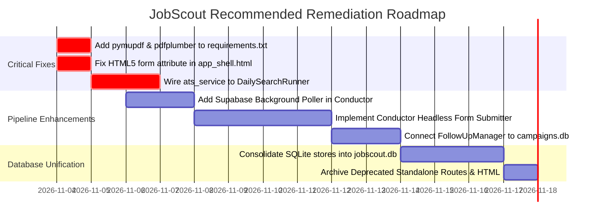

# JobScout — Code Defects, Gaps, and Missing Features

> **Document:** `ISSUES_AND_MISSING_FEATURES.md`  
> **Platform Version:** 3.14  
> **Audit Date:** 2026-11-03  
> **Evidence Standard:** Code inspection, line-number citations, and empirical test execution results

---

## 1. Confirmed Code Defects & Test Failures

Dynamic test execution of the automated test suite (`294` collected tests) revealed **5 test failures** across CV parsing, autonomous execution mocking, and template consolidation.

### Defect 1: Missing `pymupdf` Dependency Breaks Advanced CV Parsing
- **Location:** [`services/cv_parser.py`](file:///c:/Users/provincesettat/Desktop/ftr/pro-main/services/cv_parser.py#L90-L95), [`tests/test_cv_parser.py#L177-L200`](file:///c:/Users/provincesettat/Desktop/ftr/pro-main/tests/test_cv_parser.py#L177-L200)
- **Error Output:**
  ```text
  FAILED tests/test_cv_parser.py::TestCVParser::test_extract_profile_photo_with_pymupdf - ModuleNotFoundError: No module named 'pymupdf'
  FAILED tests/test_cv_parser.py::TestCVParser::test_extract_tables_with_pdfplumber - ModuleNotFoundError: No module named 'pymupdf'
  FAILED tests/test_cv_parser.py::TestCVParser::test_pymupdf_metadata_and_thumbnail - AssertionError: 0 != 1
  ```
- **Root Cause Analysis:** `requirements.txt` specifies `pypdf>=4.3` but omits `pymupdf` (fitz) and `pdfplumber`. While `CVParser` includes defensive try-except fallback blocks, the advanced document processing capabilities (extracting candidate portrait photos, extracting tabulated CV work history, and rendering preview thumbnails) crash with `ModuleNotFoundError` if invoked.
- **Evidence:** `requirements.txt` lines 1–11 show `pymupdf` is not listed.

---

### Defect 2: Missing HTML5 `form` Attribute on Consolidated Search Source Select
- **Location:** [`templates/app_shell.html`](file:///c:/Users/provincesettat/Desktop/ftr/pro-main/templates/app_shell.html#L210), [`tests/test_search_maps_consolidation.py#L20`](file:///c:/Users/provincesettat/Desktop/ftr/pro-main/tests/test_search_maps_consolidation.py#L20)
- **Error Output:**
  ```text
  FAILED tests/test_search_maps_consolidation.py::test_maps_is_one_workspace_inside_search
  KeyError: 'form'
  > assert page.select_one('#search_source_1')['form'] == 'search_form_1'
  ```
- **Root Cause Analysis:** The test asserts that the `#search_source_1` select element explicitly references its parent form via `form="search_form_1"`. In `templates/app_shell.html`, the element is nested within `<form id="search_form_1">` but omits the explicit HTML5 `form` attribute, causing BeautifulSoup's attribute dictionary lookup to raise a `KeyError`.

---

### Defect 3: Conductor Worker Loop Mock Assertion Discrepancy
- **Location:** [`services/conductor_engine.py#L110-L149`](file:///c:/Users/provincesettat/Desktop/ftr/pro-main/services/conductor_engine.py#L110-L149), [`tests/test_autonomous_audit.py#L125`](file:///c:/Users/provincesettat/Desktop/ftr/pro-main/tests/test_autonomous_audit.py#L125)
- **Error Output:**
  ```text
  FAILED tests/test_autonomous_audit.py::test_worker_executes_due_search_and_inbox
  AssertionError: Expected 'run_daily_search_for_client' to have been called once. Called 0 times.
  ```
- **Root Cause Analysis:** In `test_worker_executes_due_search_and_inbox`, the test mocks `client_manager.list_clients` returning `[{'id': 'candidate'}]`. However, in `ConductorEngine._check_and_run_due_daily_searches()` (lines 207–234), the engine queries `conductor_store.get_client_automation_config(client_id)` to verify if the candidate has `is_active == 1` and if `next_run_at <= now()`. Because the test setup did not insert an active automation config in the test SQLite store, the daily search runner was skipped.

---

### Defect 4: Hardcoded Candidate Profile Fallback in ATS Service
- **Location:** [`pdf_generator/services/ats_service.py`](file:///c:/Users/provincesettat/Desktop/ftr/pro-main/pdf_generator/services/ats_service.py#L53), [`pdf_generator/services/ats_service.py#L92`](file:///c:/Users/provincesettat/Desktop/ftr/pro-main/pdf_generator/services/ats_service.py#L92), [`pdf_generator/services/ats_service.py#L408`](file:///c:/Users/provincesettat/Desktop/ftr/pro-main/pdf_generator/services/ats_service.py#L408)
- **Evidence:**
  ```python
  def load_candidate_profile_bullets(profile_id="anass_sibbi"):
      ...
  def load_candidate_info(profile_id="anass_sibbi") -> dict:
      ...
  def generate_ats_heatmap(company_name: str, job_title: str, requirements: str = "", profile_id: str = "anass_sibbi") -> dict:
      ...
  ```
- **Root Cause Analysis:** If a frontend or service caller does not pass `profile_id`, the ATS optimization engine defaults to loading candidate bullets for `"anass_sibbi"`. If another candidate is active in the session, their cover letter keywords may inadvertently be tailored against the wrong candidate profile if `profile_id` is omitted.

---

## 2. Incomplete & Disconnected Functionality

### 2.1 Conductor Drops Web Form Links (No Headless Form Submitter)
- **Status:** **CRITICAL ARCHITECTURAL GAP**
- **Affected Files:** [`services/conductor_store.py`](file:///c:/Users/provincesettat/Desktop/ftr/pro-main/services/conductor_store.py), [`services/daily_search_runner.py#L158-L260`](file:///c:/Users/provincesettat/Desktop/ftr/pro-main/services/daily_search_runner.py#L158-L260)
- **Details:** When `scraper/application_form_discovery.py` crawls job vacancies, it categorizes opportunities into `email`, `form`, or `both` and saves the web portal URL in column `form_link`. However:
  1. `conductor_store.py` schema for table `client_matches` does not store `form_link` or `application_method`.
  2. `DailySearchRunner._find_matches_from_datasets` filters vacancies based only on the presence of an email address.
  3. `ConductorEngine` has no server-side browser automation module (Playwright or Selenium) to automatically fill and submit web application forms when `auto_apply == 1`.

---

### 2.2 Cover Letters in Conductor Daily Search Use Static Dummy Templates
- **Status:** **DISCONNECTED SUBSYSTEM**
- **Affected Files:** [`services/daily_search_runner.py`](file:///c:/Users/provincesettat/Desktop/ftr/pro-main/services/daily_search_runner.py#L293-L356)
- **Details:** While JobScout possesses a DIN 5008 PDF generator and an AI ATS tailoring engine in `pdf_generator/`, `DailySearchRunner._generate_cover_letter_for_match` completely bypasses them. It uses a static German text string with hardcoded dummy placeholder addresses:
  ```python
  # daily_search_runner.py line 310:
  sender_address = (
      f"{cand_name}\n"
      f"{addr.get('street', 'Musterstraße 12')} {addr.get('house_number', '')}\n"
      f"{addr.get('postal_code', '50667')} {addr.get('city', 'Köln')}"
  )
  ```
- **Impact:** Automatically dispatched emails in Conductor do not benefit from AI keyword tailoring, golden hook openers, or professional DIN 5008 vector letterheads.

---

### 2.3 Supabase Paid Applications Require Manual Import
- **Status:** **PARTIAL AUTOMATION**
- **Affected Files:** [`services/conductor_engine.py`](file:///c:/Users/provincesettat/Desktop/ftr/pro-main/services/conductor_engine.py#L145-L212), [`services/onboarding_service.py`](file:///c:/Users/provincesettat/Desktop/ftr/pro-main/services/onboarding_service.py)
- **Details:** Candidates who submit their applications on Supabase and settle their invoices (`is_payed = true`) remain un-imported until an administrative user logs into `/supabase` and manually clicks "Import Candidate". `ConductorEngine` has no scheduled task to poll `SupabaseService` for un-imported paid candidates.

---

### 2.4 Follow-Up Manager is Isolated from Conductor Engine
- **Status:** **ORPHANED BACKEND MODULE**
- **Affected Files:** [`email_sender/follow_up.py`](file:///c:/Users/provincesettat/Desktop/ftr/pro-main/email_sender/follow_up.py#L24-L75)
- **Details:** `FollowUpManager` reads from `data/outreach_history.json` (a legacy tracking file) rather than `data/campaigns.db` or `conductor_store.client_matches`. As a result, follow-up reminders and polite 14-day check-in emails are never dispatched by the autonomous daemon.

---

## 3. UI-Only and Mock Features

The following user interface controls exist in the frontend templates or scripts but lack functional backend execution logic:

1. **AI Monthly Spend Cap & Budget Alert:**
   - **File:** [`static/spa/sections/ai-settings.js`](file:///c:/Users/provincesettat/Desktop/ftr/pro-main/static/spa/sections/ai-settings.js)
   - **Details:** Input field for monthly dollar budget cap exists in the UI, but `services/ai_provider_manager.py` does not check or enforce the limit during LLM completion calls.
2. **External Dataset Schema Mapping Dialog:**
   - **File:** [`static/spa/sections/ausbildungen.js`](file:///c:/Users/provincesettat/Desktop/ftr/pro-main/static/spa/sections/ausbildungen.js)
   - **Details:** Modal interface exists for remapping column names from third-party Excel files, but the submit button does not call a backend endpoint.
3. **WhatsApp Interactive Button Template Dispatcher:**
   - **File:** [`static/spa/sections/whatsapp.js`](file:///c:/Users/provincesettat/Desktop/ftr/pro-main/static/spa/sections/whatsapp.js)
   - **Details:** Visual previews for WhatsApp quick-reply buttons exist in the chat configuration tab, but `services/whatsapp_service.py` currently only sends text and media messages via the Meta Cloud API.

---

## 4. Redundant & Deprecated Code

The following modules represent legacy code superseded by the single-page application (SPA) architecture and can be safely archived:

1. **Standalone PDF Generator Frontend:**
   - **Path:** [`pdf_generator/frontend/`](file:///c:/Users/provincesettat/Desktop/ftr/pro-main/pdf_generator/frontend/) (`index.html`, `script.js`, `styles.css`)
   - **Reason:** Completely superseded by the integrated SPA section `static/spa/sections/create-anschreibens.js`.
2. **Server-Rendered Search View & Legacy Templates:**
   - **Paths:** [`templates/results.html`](file:///c:/Users/provincesettat/Desktop/ftr/pro-main/templates/results.html), [`templates/index.html`](file:///c:/Users/provincesettat/Desktop/ftr/pro-main/templates/index.html), [`templates/extraction_progress.html`](file:///c:/Users/provincesettat/Desktop/ftr/pro-main/templates/extraction_progress.html), [`templates/auto_extraction_progress.html`](file:///c:/Users/provincesettat/Desktop/ftr/pro-main/templates/auto_extraction_progress.html)
   - **Reason:** Replaced by client-side SSE streaming and inline progress cards in `static/spa/sections/search.js` and `ausbildungen.js`.
3. **Standalone Node.js Server:**
   - **Path:** [`ai-job-autofill/server/server.js`](file:///c:/Users/provincesettat/Desktop/ftr/pro-main/ai-job-autofill/server/server.js)
   - **Reason:** All autofill endpoints (`/api/autofill/map-fields`, `/api/autofill/upload-cv`, etc.) have been natively reimplemented in Python in [`routes/autofill.py`](file:///c:/Users/provincesettat/Desktop/ftr/pro-main/routes/autofill.py).

---

## 5. Strategic Remediation Plan


